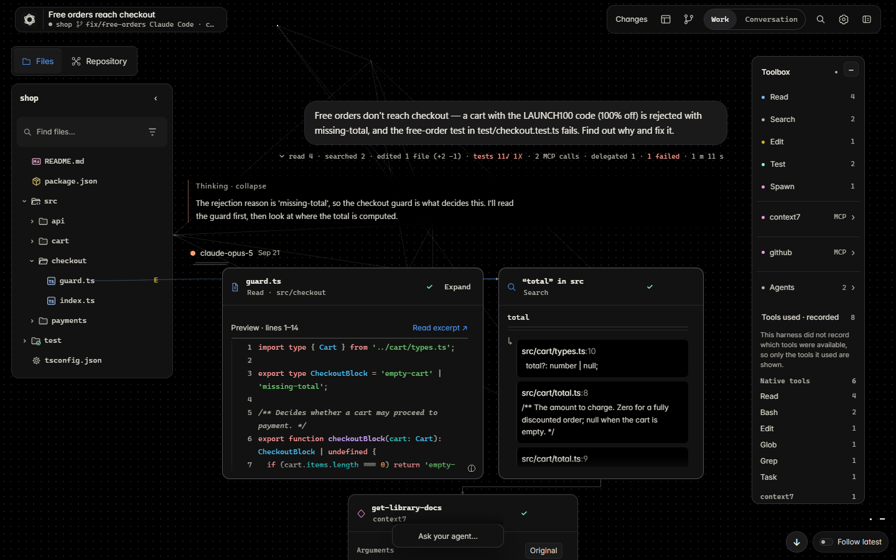
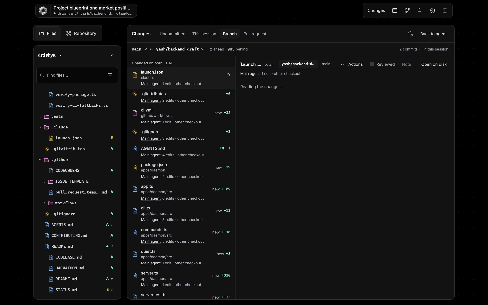
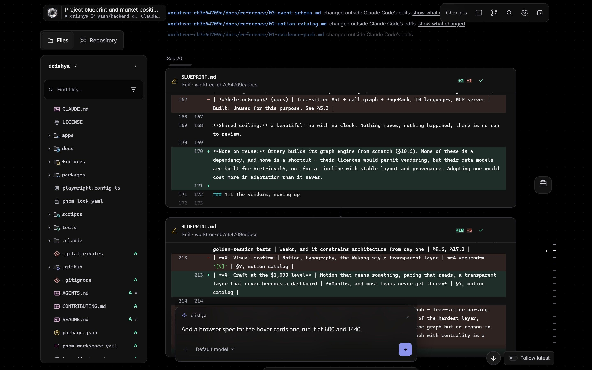

<p align="center">
  <picture>
    <source media="(prefers-color-scheme: dark)" srcset="assets/brand/mark-on-dark.svg">
    
  </picture>
</p>

<h1 align="center">Drishya</h1>

<p align="center">
  <b>See what your coding agent is doing, and review it like an engineer.</b><br>
  <sub>दृश्य &nbsp;·&nbsp; <i>that which is seen</i></sub>
</p>

<p align="center">
  &nbsp;
  &nbsp;
  
</p>

<p align="center">
  <a href="LICENSE"></a>
  
  
  
</p>

<p align="center">
  <a href="#quick-start"><b>Quick start</b></a> &nbsp;·&nbsp;
  <a href="#features">Features</a> &nbsp;·&nbsp;
  <a href="#agents">Agents</a> &nbsp;·&nbsp;
  <a href="#privacy">Privacy</a> &nbsp;·&nbsp;
  <a href="#security-tested">Security</a> &nbsp;·&nbsp;
  <a href="#contributing">Contributing</a> &nbsp;·&nbsp;
  <a href="https://drishya-dev.github.io/drishya/">Website</a>
</p>

<br>

<p align="center">
  
</p>

<br>

Your agent reads thirty files, runs ten commands, watches a test fail, edits two lines and says **"Done."**
Drishya shows you all of it, as it happens: the real files, output and diffs, next to your repository, with the tools to review the change.

## Features

<table>
  <tr>
    <td width="33%" valign="top">
      <br>
      <b>Watch live</b><br>
      <sub>Every read, search, command, test and edit appears as the agent takes it, shown as the real content.</sub>
    </td>
    <td width="33%" valign="top">
      <br>
      <b>Read along</b><br>
      <sub>Open the file the agent is working on beside its work, with every earlier action and diff on it.</sub>
    </td>
    <td width="33%" valign="top">
      <br>
      <b>Steer</b><br>
      <sub>Answer the agent's questions and approvals, and send the next prompt to a Claude Code or Codex session.</sub>
    </td>
  </tr>
  <tr>
    <td width="33%" valign="top">
      <br>
      <b>Review</b><br>
      <sub>Workspace, Changes for branches and pull requests, and the Git graph, each showing which agent touched what.</sub>
    </td>
    <td width="33%" valign="top">
      <br>
      <b>Replay and search</b><br>
      <sub>Every session from every agent on one Home. Replay it, read it as work or conversation, and search the ones you have opened.</sub>
    </td>
    <td width="33%" valign="top">
      <br>
      <b>Private</b><br>
      <sub>Runs on your machine. Secrets are redacted before anything is stored. No telemetry.</sub>
    </td>
  </tr>
</table>

<table>
  <tr>
    <td width="50%"></td>
    <td width="50%"></td>
  </tr>
  <tr>
    <td align="center"><sub><b>Workspace</b></sub></td>
    <td align="center"><sub><b>Changes</b></sub></td>
  </tr>
  <tr>
    <td width="50%"></td>
    <td width="50%"></td>
  </tr>
  <tr>
    <td align="center"><sub><b>Git graph</b></sub></td>
    <td align="center"><sub><b>Composer</b></sub></td>
  </tr>
</table>

<details>
<summary><b>Why it exists</b></summary>
<br>

| The problem | What Drishya does |
|---|---|
| Code lands that nobody has read. | Each step is visible as it happens, so even a change you skimmed leaves a trail you can follow. |
| The agent explored dozens of files; you get one sentence. | Every step in order, with the output it got back. |
| You can't judge its plan without seeing what it saw. | The file it is reading, beside its work, with that file's history. |
| Review is spread across a terminal, an editor, a Git client and GitHub. | One window, next to the agent's work. |
| Every agent keeps its own history. | All of them on one Home, replayable and searchable. |

Where an agent did not record its reasoning, Drishya says *Reasoning not recorded* rather than guessing.

</details>

## Agents

<table>
  <tr>
    <th></th><th align="left">Agent</th><th>Live view</th><th>Replay</th><th>Send prompts</th>
  </tr>
  <tr>
    <td></td><td><b>Claude Code</b></td><td align="center">✓</td><td align="center">✓</td><td align="center">✓</td>
  </tr>
  <tr>
    <td></td><td><b>Codex</b></td><td align="center">✓</td><td align="center">✓</td><td align="center">✓</td>
  </tr>
  <tr>
    <td></td><td><b>Antigravity</b></td><td align="center">–</td><td align="center">✓</td><td align="center">–</td>
  </tr>
</table>

**Exploring next**

<p>
  &nbsp; <b>T3 Code</b>
  &emsp;&emsp;
  &nbsp; <b>Hermes Agent</b>
</p>

<sub>Not promised for a date. Want another agent? <a href="https://github.com/drishya-dev/drishya/issues/new?template=harness-integration.yml">Open an issue</a>, or add one: <a href="docs/CODEBASE.md#adapters--how-to-add-a-harness">how adapters work</a>.</sub>

<details>
<summary>Where Drishya finds sessions</summary>
<br>

Drishya reads each agent's own journals, read-only, where the agent already writes them.

| Agent | Location | Override |
|---|---|---|
| Claude Code | `~/.claude/projects` | `DRISHYA_CLAUDE_HOME` |
| Codex | `~/.codex/sessions` | `DRISHYA_CODEX_HOME` or `CODEX_HOME` |
| Antigravity | `~/.gemini/antigravity` | `DRISHYA_ANTIGRAVITY_HOME` |

Antigravity support is the newest and has had the least real-world use; Drishya never starts or steers an Antigravity session. Agent journals are not a stable, documented format, so unknown records are shown as unknown rather than guessed.

</details>

## Quick start

Requires **Node.js 24**.

```bash
npx drishya serve
```

Or install it with `npm install -g drishya` and run `drishya serve`. On Windows, open a new terminal if it cannot find the command after installation.

`serve` opens Drishya in your browser. **Home** lists the sessions it finds; open one to follow it live or replay it.
No sessions yet? Open `http://127.0.0.1:7878/?demo` for a sample.

<details>
<summary>Requirements</summary>
<br>

- **Node.js 24 or newer** (`>=24`). Drishya uses Node's built-in SQLite and has no runtime dependencies.
- A desktop browser, at least 600 px wide.
- `git`, for Files and Changes. The GitHub CLI (`gh`) is optional, for pull requests.
- To send prompts: `claude` or `codex` installed and signed in.

Hand-tested on Windows 11. It is plain Node with no native add-ons. CI runs type checks, unit and security tests, package verification and browser tests on Windows, Ubuntu and macOS, with [documented hosted-browser exclusions](playwright.config.ts). A clean Linux install (Ubuntu under WSL2, Node 24) has been checked by hand. macOS has not been hand-tested on a physical Mac yet.

</details>

<details>
<summary>Run from source</summary>
<br>

```bash
git clone https://github.com/drishya-dev/drishya.git
cd drishya
corepack pnpm install --frozen-lockfile
corepack pnpm ui:build
corepack pnpm serve
```

Rebuild the UI (`corepack pnpm ui:build`) after updating the source.

</details>

<details>
<summary>First run, step by step</summary>
<br>

1. `serve` opens the browser with a short-lived, single-use sign-in link and prints a separate fallback link in the terminal. The printed link carries a random token valid for this daemon launch. If the browser does not open, copy that printed link. Keep both links private.
2. **Home** lists the sessions Drishya found. A session is imported when you first open it. If the list is empty, finish a turn in Claude Code or Codex in a Git checkout and return to Home.
3. To let Drishya read a repository's current files, choose **Enable workspace reading** in the Files rail. It asks once per checkout and never writes to it.
4. To send a prompt, open a Claude Code or Codex session with its native CLI installed and signed in. Expand the prompt composer if it is closed, enter a prompt, and choose **Send prompt**. When prompted, confirm the session is idle in other clients before choosing **Confirm and send**.
5. Stop with Ctrl+C. Use `--port` if the default port (7878) is taken.


</details>

<details>
<summary>Command line</summary>
<br>

With the npm install use `drishya <command>`; from a checkout use `corepack pnpm drishya <command>`.

| Command | What it does |
|---|---|
| `serve [--port 7878] [--no-open]` | Start the app |
| `sources [--json]` | List the sessions found on this machine |
| `import <path>` | Import one session journal |
| `import --latest [claude-code\|codex]` | Import the most recent session |
| `list` | List imported recordings |
| `export <recording> --out <file>` | Write a sanitized replay bundle |
| `forget <recording>` | Remove a recording from the store |
| `storage` | Show disk use against a 10 GiB advisory budget |

</details>

<details>
<summary>Uninstall</summary>
<br>

1. Stop Drishya (Ctrl+C).
2. Delete its data directory: `~/.drishya` (`%USERPROFILE%\.drishya` on Windows), or wherever `DRISHYA_HOME` points.
3. Delete your checkout, or run `npm uninstall -g drishya`.

To remove a single session, use `drishya forget <recording>`. Removing Drishya's data does not remove the original harness journals or changes made by a native harness after you sent it a prompt.

</details>

## Privacy

<table>
  <tr><td><b>Reads</b></td><td>Your agents' journals, read-only. A repository's files only after you allow it, and its Git data through fixed <code>git</code> commands with no shell.</td></tr>
  <tr><td><b>Stores</b></td><td>Redacted copies of what it imports, in <code>~/.drishya</code>. Nothing is written to your repositories or your agents' folders.</td></tr>
  <tr><td><b>Sends</b></td><td>Nothing. No telemetry, analytics, crash reports or update checks. The page loads nothing from other hosts.</td></tr>
  <tr><td><b>Listens</b></td><td>On <code>127.0.0.1</code> only (port 7878 by default). Every request for your data needs the launch token or an authenticated session cookie.</td></tr>
  <tr><td><b>Redacts</b></td><td>Matched keys, tokens, JWTs, URL credentials, strings in structured secret fields and protected-file contents such as <code>.env</code>, <i>before</i> storage, indexing, export or display. Redaction is best effort; review exports before sharing.</td></tr>
</table>

The optional GitHub integration runs your own signed-in `gh`, and sending a prompt runs your own `claude` or `codex`. Both are off until you use them.

> [!IMPORTANT]
> **Keep Drishya on your own machine.** Don't put its port behind a reverse proxy or a tunnel, and don't forward it (VS Code, SSH, WSL or Docker port forwarding).
>
> **This is not a known vulnerability, and nothing is exposed by default.** Drishya binds to `127.0.0.1` and refuses any other address. This note is about a setup you would have to create yourself: once the port is reachable from elsewhere, anyone who obtains your launch link could read your sessions.

<details open>
<summary><b>If the port is exposed anyway, what still protects you</b></summary>
<br>

- **No token, no access.** Every request for your data needs the launch token or the session cookie it was exchanged for, and is refused (401) without one. The token is random on every launch, compared in constant time, sent only in a header (never read from a URL query), and never written to disk or logs. The link your browser is opened with carries a one-time code that expires after two minutes, not the token itself. The cookie is `HttpOnly` and `SameSite=Strict`, expires after 12 hours idle or 7 days, and at most 32 sessions are kept.
- **Foreign requests are refused.** A request for a host name other than localhost is refused (421), a request from another website's origin is refused (403), and no cross-origin headers are ever sent. State-changing requests must be JSON, which a cross-site form cannot send. A proxy that rewrites the host name gets past the first check, which is why the token is the lock that matters.
- **Matched secrets are removed before storage.** The security suite plants 28 canaries for the 27 text-pattern rules in every agent's journal and checks that none reaches the database, search index, exports or screen. Structured secret fields (such as `password` and `apiKey`) also have their string values redacted, including short values that match no text pattern; [dedicated tests](tests/security/15-structured-secrets.test.ts) cover them.
- **Prompting needs your consent.** Sending a prompt needs the consent you gave for that checkout in the app, and each approval answers one exact request once.

Redaction is best effort: a secret that matches no pattern is not caught. That is why the port belongs on your own machine.

Found a problem? Report it privately through [SECURITY.md](SECURITY.md). Each line above is a test: see [Security, tested](#security-tested).

</details>

## Security, tested

Drishya's security claims are tests you can run yourself. `corepack pnpm test:security` ran on `main` at `69d3c467` on 18 November 2026 (Windows 11, Node 24.11.1, UI built): **705 tests in 21 files, 700 passed, 5 skipped, 0 failed**, in about two minutes. All five skips are Linux and macOS file-permission tests. These counts describe this source-suite run; the final shipping package still needs the release checks below.

| Suite | Tests | What it proves |
|---|---:|---|
| **Request gate** | 241 | The route list is read from the server's own source, so a new route is covered the day it is added. Without the launch token or a session, every protected API route answers 401. The version probe and sign-in exchange are public. No cross-origin headers or preflight; writes must be JSON; sessions expire and can be revoked; the token stays out of logs and responses. |
| **Host and Origin** | 193 | Every route refuses a foreign Host (421) and a foreign Origin (403), even with a valid session, including DNS-rebinding-style names. |
| **Secrets canaries** | 11 | One invented secret per redaction rule is planted in each agent's journals. The database, blobs, previews, search index, exports, offline bundle, API responses, logs and error bodies are searched for the raw values. Every rule is also timed against hostile input so none can hang ingest. |
| **Outbound traffic** | 6 | A full walk of the app with default settings sends nothing beyond loopback. Each opt-in (GitHub, prompts) sends exactly what is listed. The built page loads nothing from another host. No update check. |
| **Command execution** | 8 | Native harnesses, Git and `gh` are started with argument lists and shell execution disabled. On Windows, the browser opener uses `cmd /c start` with a generated URL-safe launch link. Captured text cannot become an option. The executable cannot come from a repository. Git runs with its extension points off and never touches the network. |
| **Package** | 49 | What the npm package may contain (paths, manifest, file contents, imports) and that the daemon has no runtime dependencies. Each rule is shown failing when the thing it guards appears. |

Another 127 passing tests cover loopback-only binding (12), file access (59), hostile journal content (20), size and rate limits (12), what the page may keep (4), prompt sending and approvals (8) and the first five suspicions written down before the suite (12). The penetration-regression file has 44 tests (42 passed, 2 platform skips). A further 26 cover structured secrets, checkpoint lineage, export isolation, Git storage boundaries, recorded network paths, per-file statistics, local inputs and store permissions (23 passed, 3 platform skips).

**Run it yourself**

```bash
corepack pnpm install --frozen-lockfile
corepack pnpm ui:build                   # includes the built-page outbound check
corepack pnpm test:security              # the suite above
corepack pnpm test:security:mutations    # removes each defence in turn and checks that a test fails
corepack pnpm package:verify             # builds the real package and checks it
```

**Penetration pass.** The release candidate, packed and installed as a user would, was attacked with a hostile web page in Edge and Firefox, DNS rebinding with real DNS, a seeded fuzzer (28,215 requests across all 95 routes), a network scan, a hostile repository and static analysis. It found **8 issues**, two high, two medium, four low. All are fixed, each with a regression test that fails without the fix. The report keeps the evidence and the open items.

<!-- Replace the paragraph below with the result once the hands-on pass has been repeated on the published package. Do not claim it before. -->
**Before 0.1.0**, the automated scans were repeated on the release candidate: Semgrep, OWASP ZAP and CodeQL found nothing new beyond one accepted item (the page's content policy allows inline styles; scripts stay blocked). The full hands-on pass has not yet been repeated on the published package. Its result will be added here.

For the current candidate scope and platform limits, read the [0.1.0 release notes](docs/release-notes-0.1.0.md). Final-package verification, security acceptance and builder sign-off are tracked in the [release checklist](docs/release-checklist.md).

Read the tests in [`tests/security/`](tests/security), the [threat model](docs/review/sec-3-threat-model.md) for what is defended and what is accepted, and the [penetration test report](docs/review/sec-4-pentest.md). Report a vulnerability privately through [SECURITY.md](SECURITY.md).

## Develop

```bash
corepack pnpm install --frozen-lockfile
corepack pnpm ui:dev          # UI with hot reload
corepack pnpm dev             # daemon in development mode
corepack pnpm check           # typecheck and unit tests
corepack pnpm test:security   # security suite
corepack pnpm test:browser    # browser suite
```

TypeScript run directly on Node 24 over `node:sqlite` and `node:http`, with a React 19 and Vite front end. [docs/CODEBASE.md](docs/CODEBASE.md) maps the packages; read [CONTRIBUTING.md](CONTRIBUTING.md) before opening a pull request.

## Contributing

**Developers.** Missing a feature you want? Propose it in an [idea issue](https://github.com/drishya-dev/drishya/issues/new?template=idea.yml), say you are taking it, and build it. Start with [CONTRIBUTING.md](CONTRIBUTING.md) (how to run, check and submit a change), the [roadmap](ROADMAP.md) and the [open issues](https://github.com/drishya-dev/drishya/issues); `good first issue` is the gentlest way in.

**Agent makers and their communities.** If you build or use a coding agent, help Drishya show its work. An adapter reads the agent's own session records, read-only, and the rest of the product works unchanged. [How to add a harness](docs/CODEBASE.md#adapters--how-to-add-a-harness) has the steps, and the [Harness integration](https://github.com/drishya-dev/drishya/issues/new?template=harness-integration.yml) issue form is the place to say what your agent records and where. If you maintain the agent, the form has a place to say so.

**Feedback.** A bug, an idea or a question: [open an issue](https://github.com/drishya-dev/drishya/issues/new/choose). The same link is in the app, on Home and in Settings; it opens GitHub, and Drishya sends nothing.

## Maintainers

Drishya is built and maintained by **Harsh Jain** and **Yash Doke**. The [Code of Conduct](CODE_OF_CONDUCT.md) applies, the [changelog](CHANGELOG.md) records releases, and [AGENTS.md](AGENTS.md) holds the rules for coding agents working in this repository.

## License

The code is licensed under the [Apache License 2.0](LICENSE). The **Drishya name and logo are not licensed for other products** (see [TRADEMARKS.md](TRADEMARKS.md); brand files are in [assets/brand](assets/brand/README.md)). Agent names and logos belong to their owners and are shown only to say which agents Drishya works with.
