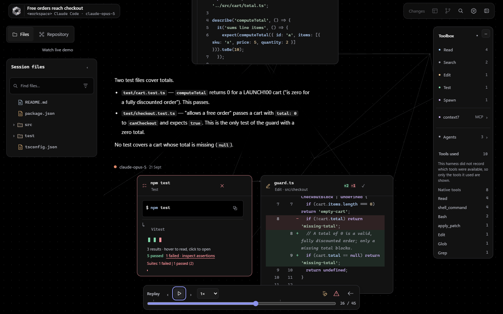
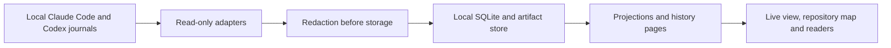

<p align="center">
  
</p>

# Drishya

**See what your coding agents did. Understand what changed.**

Drishya is a local live view and replay for **Claude Code and Codex**. It connects the source an agent read, the commands it ran, the output it received and the diffs it wrote to your repository, so you can understand the work while it happens or catch up afterward.

Built for developers who delegate multi-file work to agents and need to review the result, learn the codebase, or pick up where a session left off.

**दृश्य** — *“that which is seen.”*

[Quick start](#quick-start) · [Features](#features) · [Usage](#usage) · [Privacy](#privacy-and-control) · [Development](#development) · [Documentation](#documentation)



*The built-in synthetic demo. No private session data is shown.*

> **Status: working local product candidate, under active development.** Run from a developer checkout today; there is no published `npx drishya` installation. Product finishing, physical/platform testing and human acceptance remain in progress. See the [current work list](docs/TASKS.md).

## Why Drishya?

An agent can spend twenty minutes reading files, trying commands and changing code. The final diff shows the result; the context is scattered across the session.

Drishya brings that captured material together. Follow a file from its read to its edit, inspect the output behind a test result, or return to the prompt that started a stretch of work. You can watch live or look away and come back to a readable history.

The goal is simple: **understand both the agent's changes and the codebase they belong to.**

## Features

| What you want to do | What Drishya provides |
|---|---|
| **Follow work as it happens** | Import or watch local Claude Code and Codex sessions. New captured work accumulates while you scroll back to read. |
| **Read the evidence** | Inspect captured source excerpts, patches, command output, searches and tool results. Available images, plans, questions and sub-agent activity retain their recorded context. |
| **Find your place in the repository** | Explore the repository map and Files rail, open a quick file peek, or use Workspace for deeper reading and local drafts. Current files and historical evidence are distinguished. |
| **Review a change** | Follow file history, compare available captured states and inspect current Git changes with explicit workspace access. Captured history and today's Git state stay separate. |
| **Catch up after a run** | Search captured work, navigate prompts, revisit saved moments and inspect recorded failures and test outcomes. Optional sequence replay adds playback and scrubbing. |
| **Keep agents identifiable** | Read multiple imported sessions in a combined chronology, with captured agent identities and supported parent/child relationships. Unresolved ownership stays explicit. |
| **Continue when you choose** | An opt-in composer can resume a selected native session through supported harness protocols, with explicit consent and conservative permissions. |
| **Keep the core local** | Store recordings on your machine, use the synthetic demo without a model account, and export sanitized replay bundles for deliberate sharing. Zero telemetry. |

Availability depends on what the harness actually records. Missing bytes, encrypted reasoning, capture gaps and unknown outcomes remain visible; Drishya does not invent the missing content.

## Quick start

### Requirements

- **Node.js 24.x** — the workspace requires `>=24 <25`.
- **pnpm 10.34.5** — pinned in [`package.json`](package.json). If pnpm is unavailable, replace `pnpm` in the commands below with `npx pnpm@10.34.5`.
- **Git** and access to this repository.
- A **desktop browser** and a window at least **600 px wide**. Phone and touch layouts are outside the supported scope.
- Local **Claude Code or Codex journals** to inspect your own work. Neither harness nor a model API key is needed for the synthetic demo.

Windows is the current reference environment. Broader Windows hardware, macOS and Linux acceptance remain release checks; this is not a claim of platform-wide certification.

### Install and launch

```bash
git clone https://github.com/drishya-dev/drishya.git
cd drishya
pnpm install --frozen-lockfile
pnpm ui:build
pnpm serve
```

The launcher starts the local app on **`127.0.0.1:7878`** and opens your browser. If it does not open, use the **`Open:` authentication link printed in your terminal**. A normal launch creates a fresh token; reopening the bare address is not a substitute for that link.

You should see the session library, including discovered local sessions. Choose **Import** to read a recorded session or **Watch live** to follow its journal. Discovery does not automatically import every session.

Stop the server with **Ctrl+C**. Imported recordings remain in the local store for your next launch.

### Try the demo first

After launching, open [the synthetic demo](http://127.0.0.1:7878/?demo). It uses the built-in Claude Code/Codex checkout example, with no private journal import or model call. It demonstrates recorded work; it does not start a real agent.

For the captured edit, open [the demo at step 26](http://127.0.0.1:7878/?demo&at=26). Add `&motion=0` to disable motion. These links assume the default port and a running local app.

## Usage

### Watch now, read later

1. Open a discovered session with **Watch live**.
2. Follow the captured reads, edits and tool results in history. Open an action to read its material.
3. Scroll back when something needs attention. Capture continues independently of your reading position.
4. Use **Back to latest** or the Follow control to return to incoming work.

Watching means Drishya is tailing a journal. It does not, by itself, prove the agent is still running. Sequence replay is a separate, optional way to inspect recorded work.

### Import a journal from another location

The session library is the easiest entry point. For journals outside the discovered locations, run this from the checkout, replacing the quoted path with your actual file:

```bash
pnpm drishya import "/path/to/session.jsonl"
pnpm drishya list
```

The importer detects the harness and reports the recording ID, added observations and capture gaps. Add `--live` to keep following the selected journal until Ctrl+C. Native source journals are opened read-only.

### Export a recording

Use the recording ID from `pnpm drishya list` in place of `RECORDING_ID`:

```bash
pnpm drishya export RECORDING_ID --out replay.json
```

This writes a sanitized replay bundle. **Review it before sharing:** secret-pattern detection is best effort, and source code, paths or other sensitive context can still matter. Offline replay bundles are read-only.

### Useful commands

Run these from the repository root:

| Command | Purpose |
|---|---|
| `pnpm serve --no-open` | Start the app and print its launch link without opening a browser. |
| `pnpm serve --port 7879` | Use a different local port. |
| `pnpm drishya` | Show CLI usage and available options. |
| `pnpm drishya sources` | List discovered Claude Code and Codex sessions. This prints local session metadata and paths. |
| `pnpm drishya list` | List imported recordings and their IDs. |
| `pnpm drishya storage` | Inspect local disk usage against the advisory storage budget. |
| `pnpm drishya forget RECORDING_ID` | Remove that imported recording and unshared stored blobs; the original harness journal remains intact. |

## Privacy and control

Drishya is a local tool. This is exactly what it does with your data.

**What it reads**

- **Agent journals**, read-only: Claude Code's (`~/.claude`) and Codex's (`~/.codex`, or `CODEX_HOME`) session files. Discovery lists them by metadata and path; nothing is imported until you choose **Import** or **Watch live**. Drishya never edits a journal or a harness configuration.
- **Your repositories**, only after you grant a checkout access. Files and Git state are read through `git` with fixed arguments and no shell. Drishya does not write your project files; Workspace drafts stay in Drishya until you download them or hand them to an agent yourself.

**What it stores**

- **On disk**, in `~/.drishya` (`%USERPROFILE%\.drishya` on Windows; set `DRISHYA_HOME` to move it): a SQLite database of imported recordings, a blob store, previews and a search index. Secrets that match a known pattern are scrubbed *before* anything is written. On Linux and macOS the folder is created private to your account (mode 0700, files 0600). Remove a recording with `pnpm drishya forget RECORDING_ID`, or delete the folder.
- **In your browser**: a session cookie (`drishya_session`, HttpOnly, SameSite=Strict) and a few interface preferences in `localStorage` under the `drishya` prefix. No service worker, cache storage or IndexedDB. The launch token and session are not written to disk.

**What it sends**

- **Nothing, by default.** No telemetry, no analytics, no update check, no crash reports, and the page loads no font, script or image from another host. A link or image address inside captured content is shown as text and is never fetched.
- **Opt-in only:** GitHub pull request and issue cards are answered by *your own* signed-in `gh` command, for `github.com` pull-request and issue URLs only, after you turn them on in Settings. Drishya holds no GitHub token of its own. If you resume a native session from the composer, *that* agent talks to its provider under its own settings, exactly as if you had started it yourself.
- **Exports** are files you save; nothing uploads them. Review one before you share it, because pattern-based redaction is best effort.

**What it listens on**

- **One port, on the loopback address only** (`127.0.0.1:7878` by default; `--port` changes it, and `--host` accepts only `127.0.0.1`, `localhost` or `::1`). Every request needs the per-launch token or the session cookie, and the daemon refuses a request whose `Host` or `Origin` is not its own, which blocks other websites and DNS rebinding.
- **Do not put that port on a network.** Do not run Drishya behind a reverse proxy or tunnel, and do not forward the port (VS Code *Ports*, SSH `-L`/`-R`, Dev Containers, WSL or Docker publishing, ngrok-style services). Anyone who reaches the port *and* holds your launch link can read everything Drishya has captured, and a proxy that rewrites `Host` defeats the protection above. If you need another machine, open the session there instead.
- The launch link (`Open:` in the terminal) contains the token. Treat it like a password: do not paste it into an issue, chat or an agent's prompt.

**How the product keeps its own promises**

- **Independent observation.** Passive viewing never modifies harness files. Repository and Git inspection need explicit access.
- **Explicit native control.** Continuing a session requires workspace consent and an acknowledgement that other clients are idle. Submission, interruption and exact approval or question replies use the harness's supported protocols; unsupported requests fail visibly. Offline bundles cannot control an agent.
- **Faithful evidence.** Captured text, derived results and current workspace state have distinct provenance. Exposed reasoning summaries appear only when the harness recorded them; encrypted or signature-only material cannot reveal private reasoning. See [tested summary settings and shell-specific guidance](docs/review/data-8-reasoning-persistence.md).

The security checks behind these statements are `pnpm test:security` ([threat model](docs/review/sec-3-threat-model.md)). To report a problem, read [SECURITY.md](SECURITY.md).

For the full boundaries, read the [engineering plan](docs/review/03-engineering-plan.md) and [connected-workspace contract](docs/review/26-connected-workspace.md).

## Troubleshooting

| Problem | What to check |
|---|---|
| Node or package installation fails | Check `node --version` is 24.x and `pnpm --version` is 10.34.5. Install from the repo root with the committed lockfile. |
| The app cannot authenticate after a restart | Reopen the new `Open:` link printed by `pnpm serve`. The old launch credential may have expired. |
| The page or UI assets are missing | Run `pnpm ui:build` before `pnpm serve`. |
| Port 7878 is already in use | Run `pnpm serve --port 7879` and use its printed link. Use that port for demo links too. |
| No sessions appear | Create a session in a supported harness, or import a known journal by its full path. The demo works without local sessions. |
| Reasoning, an image or a result is unavailable | Check whether the native recording contains readable text or bytes. Display settings cannot recover material the harness did not record. |

If you find a bug, [open an issue](https://github.com/drishya-dev/drishya/issues) with reproduction steps, runtime versions and a synthetic example when possible. Keep real journals, private source, authentication links and secrets out of issue reports.

## Development

For hot reload, install dependencies as above, then run these in **two terminals**:

```bash
# Terminal 1: local daemon
pnpm dev
```

```bash
# Terminal 2: Vite UI
pnpm ui:dev
```

Open the **`Dev UI:` link printed by the daemon**, which includes authentication for the UI on `127.0.0.1:5173`. The Vite server proxies API requests to the daemon on port 7878.

### Checks

| Command | What it checks |
|---|---|
| `pnpm check:affected` | Typechecks, related unit tests and browser specs for changed files. |
| `pnpm check` | Full typechecking and unit tests. |
| `pnpm test:browser` | Rebuilds the UI, then runs parallel and timing-sensitive browser journeys. Requires Playwright Chromium or a configured installed browser. |
| `pnpm check:real -- --list` | Lists real-session acceptance cases; imports use a scratch Drishya home. |
| `pnpm package:verify` | Builds and verifies an isolated offline package, including synthetic import and restart. This does not publish it. |
| `pnpm demo:bundle` | Regenerates the synthetic demo from committed fixtures. |

Browser setup: `pnpm exec playwright install chromium`. To use installed Chrome instead, set `DRISHYA_BROWSER_CHANNEL=chrome` in your shell before running browser checks. See [AGENTS.md](AGENTS.md) for the appropriate verification tier and real-session acceptance requirements.

### How it fits together



The daemon uses **TypeScript on Node 24**, built-in SQLite, HTTP and Server-Sent Events, with **zero runtime dependencies**. The browser uses **React 19, Vite and Zustand**, with CodeMirror for explicit draft editing. Captured text renders in the DOM; the GPU draws the repository map.

| Location | Responsibility |
|---|---|
| [`apps/daemon/`](apps/daemon/) | Local server, CLI, authenticated APIs and controller integration. |
| [`apps/ui/`](apps/ui/) | Session library, visualization, readers and Workspace. |
| [`packages/`](packages/) | Harness adapters, capture, privacy, storage, projection, scene and indexing. |
| [`fixtures/synthetic/`](fixtures/synthetic/) | Shareable example sessions and a sample repository. |
| [`tests/browser/`](tests/browser/) | Integrated browser journeys. |
| [`docs/`](docs/) | Product direction, architecture, evidence and delivery state. |

See the [codebase guide](docs/CODEBASE.md) for data flow, package boundaries and adding a harness.

## Roadmap and current limits

Claude Code and Codex are the supported integrations today. Current work focuses on product finishing, interaction quality and release acceptance. Additional harnesses and broader visualization ideas remain tracked work, not shipped promises.

Physical lower-resource machines, macOS/Linux journeys, assistive technology and human comprehension checks remain release gates. Signed-in native journeys are tracked separately from synthetic protocol tests. Existing performance measurements apply to their named machines and workloads.

The maintained roadmap is [`docs/TASKS.md`](docs/TASKS.md); [`docs/STATUS.md`](docs/STATUS.md) records progress and decisions. No public launch date is promised here.

## Contributing

Start with [CONTRIBUTING.md](CONTRIBUTING.md) and [AGENTS.md](AGENTS.md). Before implementation, check the maintained task list and existing claims with `node scripts/claims.ts`, then claim the whole item in `docs/STATUS.md`. Major changes use a short-lived branch and the other builder's review; schema changes require both builders' agreement.

Only synthetic or genuinely redacted fixtures belong in the repository. Never commit a real session recording. Preserve the core boundaries: local observation, redaction before persistence, honest provenance and a reader's control over their position.

## Documentation

| Start here | What it covers |
|---|---|
| [Documentation map](docs/README.md) | Where to look and which document wins when older guidance differs. |
| [Vision](docs/VISION.md) | The product's visual direction, motion and craft standard. |
| [Product direction](docs/PRODUCT_DIRECTION.md) | Who Drishya serves and the workflows it aims to make useful. |
| [Codebase guide](docs/CODEBASE.md) | The implementation, packages and data flow. |
| [Engineering plan](docs/review/03-engineering-plan.md) | Capture, historical artifacts, privacy and architecture. |
| [Implementation roadmap](docs/IMPLEMENTATION_ROADMAP.md) | Performance, packaging and execution gates. |
| [Tasks and acceptance](docs/TASKS.md) | The single current work list. |
| [Status and decisions](docs/STATUS.md) | Progress, ownership and recorded decisions. |

## License

Drishya is licensed under [Apache-2.0](LICENSE).
