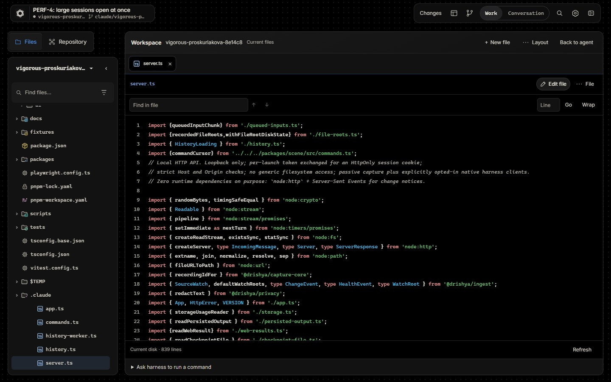
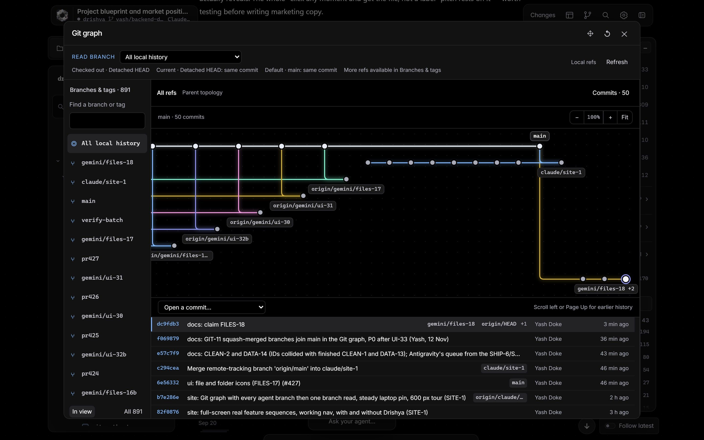

<p align="center">
  <picture>
    <source media="(prefers-color-scheme: dark)" srcset="assets/brand/mark-on-dark.svg">
    
  </picture>
</p>

<h1 align="center">Drishya</h1>

<p align="center">
  <b>See what your coding agent is doing, and review it like an engineer.</b><br>
  <sub>दृश्य &nbsp;·&nbsp; <i>that which is seen</i></sub>
</p>

<p align="center">
  &nbsp;
  &nbsp;
  
</p>

<p align="center">
  <a href="LICENSE"></a>
  
  
  
</p>

<p align="center">
  <a href="#quick-start"><b>Quick start</b></a> &nbsp;·&nbsp;
  <a href="#features">Features</a> &nbsp;·&nbsp;
  <a href="#agents">Agents</a> &nbsp;·&nbsp;
  <a href="#privacy">Privacy</a> &nbsp;·&nbsp;
  <a href="SECURITY.md">Security</a>
</p>

<br>

<p align="center">
  
</p>

<br>

Your agent reads thirty files, runs ten commands, watches a test fail, edits two lines and says **"Done."**
Drishya shows you all of it, as it happens: the real files, output and diffs, next to your repository, with the tools to review the change.

## Features

<table>
  <tr>
    <td width="33%" valign="top">
      <br>
      <b>Watch live</b><br>
      <sub>Every read, search, command, test and edit appears as the agent takes it, shown as the real content.</sub>
    </td>
    <td width="33%" valign="top">
      <br>
      <b>Read along</b><br>
      <sub>Open the file the agent is working on beside its work, with every earlier action and diff on it.</sub>
    </td>
    <td width="33%" valign="top">
      <br>
      <b>Steer</b><br>
      <sub>Answer the agent's questions and approvals, and send the next prompt to a Claude Code or Codex session.</sub>
    </td>
  </tr>
  <tr>
    <td width="33%" valign="top">
      <br>
      <b>Review</b><br>
      <sub>Workspace, Changes for branches and pull requests, and the Git graph, each showing which agent touched what.</sub>
    </td>
    <td width="33%" valign="top">
      <br>
      <b>Replay and search</b><br>
      <sub>Every session from every agent on one Home. Replay it, read it as work or conversation, search across all of them.</sub>
    </td>
    <td width="33%" valign="top">
      <br>
      <b>Private</b><br>
      <sub>Runs on your machine. Secrets are redacted before anything is stored. No telemetry.</sub>
    </td>
  </tr>
</table>

<table>
  <tr>
    <td width="50%"></td>
    <td width="50%"></td>
  </tr>
  <tr>
    <td align="center"><sub><b>Workspace</b></sub></td>
    <td align="center"><sub><b>Changes</b></sub></td>
  </tr>
  <tr>
    <td width="50%"></td>
    <td width="50%"></td>
  </tr>
  <tr>
    <td align="center"><sub><b>Git graph</b></sub></td>
    <td align="center"><sub><b>Composer</b></sub></td>
  </tr>
</table>

<details>
<summary><b>Why it exists</b></summary>
<br>

| The problem | What Drishya does |
|---|---|
| Code lands that nobody has read. | Each step is visible as it happens, so even a change you skimmed leaves a trail you can follow. |
| The agent explored dozens of files; you get one sentence. | Every step in order, with the output it got back. |
| You can't judge its plan without seeing what it saw. | The file it is reading, beside its work, with that file's history. |
| Review is spread across a terminal, an editor, a Git client and GitHub. | One window, next to the agent's work. |
| Every agent keeps its own history. | All of them on one Home, replayable and searchable. |

Where an agent did not record its reasoning, Drishya says *Reasoning not recorded* rather than guessing.

</details>

## Agents

<table>
  <tr>
    <th></th><th align="left">Agent</th><th>Live view</th><th>Replay</th><th>Send prompts</th>
  </tr>
  <tr>
    <td></td><td><b>Claude Code</b></td><td align="center">✓</td><td align="center">✓</td><td align="center">✓</td>
  </tr>
  <tr>
    <td></td><td><b>Codex</b></td><td align="center">✓</td><td align="center">✓</td><td align="center">✓</td>
  </tr>
  <tr>
    <td></td><td><b>Antigravity</b></td><td align="center">–</td><td align="center">✓</td><td align="center">–</td>
  </tr>
</table>

**Exploring next**

<p>
  &nbsp; <b>T3 Code</b>
  &emsp;&emsp;
  &nbsp; <b>Hermes Agent</b>
</p>

<sub>Not promised for a date. Want another agent? <a href="https://github.com/drishya-dev/drishya/issues">Open an issue</a>, or add one: <a href="docs/CODEBASE.md#adapters--how-to-add-a-harness">how adapters work</a>.</sub>

<details>
<summary>Where Drishya finds sessions</summary>
<br>

Drishya reads each agent's own journals, read-only, where the agent already writes them.

| Agent | Location | Override |
|---|---|---|
| Claude Code | `~/.claude/projects` | `DRISHYA_CLAUDE_HOME` |
| Codex | `~/.codex/sessions` | `DRISHYA_CODEX_HOME` or `CODEX_HOME` |
| Antigravity | `~/.gemini/antigravity` | `DRISHYA_ANTIGRAVITY_HOME` |

Antigravity support is the newest and has had the least real-world use; Drishya never starts or steers an Antigravity session. Agent journals are not a stable, documented format, so unknown records are shown as unknown rather than guessed.

</details>

## Quick start

Requires **Node.js 24**.

```bash
git clone https://github.com/drishya-dev/drishya.git
cd drishya
corepack pnpm install --frozen-lockfile
corepack pnpm ui:build
corepack pnpm serve
```

`serve` opens Drishya in your browser. **Home** lists the sessions it finds; open one to follow it live or replay it.
No sessions yet? Open `http://127.0.0.1:7878/?demo` for a sample.

<details>
<summary>Requirements</summary>
<br>

- **Node.js 24** (`>=24 <25`). Drishya uses Node's built-in SQLite and has no runtime dependencies.
- A desktop browser, at least 600 px wide.
- `git`, for Files and Changes. The GitHub CLI (`gh`) is optional, for pull requests.
- To send prompts: `claude` or `codex` installed and signed in.

Built and tested on Windows 11. It is plain Node with no native add-ons. A clean Linux run (Ubuntu 26.04 under WSL2, Node 24) passes the type checks, the unit and security tests and the installed package; some browser-suite cases still differ on Linux. macOS has not been verified yet.

</details>

<details>
<summary>Install from npm (at launch)</summary>
<br>

The package is not published yet. From launch:

```bash
npm install -g drishya
drishya serve
```

Or run it once without installing: `npx drishya serve`.

</details>

<details>
<summary>First run, step by step</summary>
<br>

1. `serve` prints a link and opens it. The link carries a random token, new on every launch, that keeps other websites out. If the browser does not open, copy the link from the terminal.
2. **Home** lists the sessions Drishya found. A session is imported when you first open it.
3. To let Drishya read a repository's current files, choose **Enable workspace reading** in the Files rail. It asks once per checkout and never writes to it.
4. Stop with Ctrl+C. The default port is 7878; use `--port` if it is taken.

Rebuild the UI (`corepack pnpm ui:build`) after every update.

</details>

<details>
<summary>Command line</summary>
<br>

With the npm install use `drishya <command>`; from a checkout use `corepack pnpm drishya <command>`.

| Command | What it does |
|---|---|
| `serve [--port 7878] [--no-open]` | Start the app |
| `sources [--json]` | List the sessions found on this machine |
| `import <path>` | Import one session journal |
| `import --latest [claude-code\|codex]` | Import the most recent session |
| `list` | List imported recordings |
| `export <recording> --out <file>` | Write a sanitized replay bundle |
| `forget <recording>` | Remove a recording from the store |
| `storage` | Show disk use against a 10 GiB advisory budget |

</details>

<details>
<summary>Uninstall</summary>
<br>

1. Stop Drishya (Ctrl+C).
2. Delete its data directory: `~/.drishya` (`%USERPROFILE%\.drishya` on Windows), or wherever `DRISHYA_HOME` points.
3. Delete your checkout, or run `npm uninstall -g drishya`.

Drishya changes nothing outside its own data directory, so there is nothing else to restore. To remove a single session, use `drishya forget <recording>`.

</details>

## Privacy

<table>
  <tr><td><b>Reads</b></td><td>Your agents' journals, read-only. A repository's files only after you allow it, and its Git data through fixed <code>git</code> commands with no shell.</td></tr>
  <tr><td><b>Stores</b></td><td>Redacted copies of what it imports, in <code>~/.drishya</code>. Nothing is written to your repositories or your agents' folders.</td></tr>
  <tr><td><b>Sends</b></td><td>Nothing. No telemetry, analytics, crash reports or update checks. The page loads nothing from other hosts.</td></tr>
  <tr><td><b>Listens</b></td><td>On <code>127.0.0.1</code> only (port 7878 by default). Every request for your data needs the launch token.</td></tr>
  <tr><td><b>Redacts</b></td><td>Keys, tokens, JWTs, credentials in URLs and the contents of files such as <code>.env</code>, <i>before</i> anything is stored, indexed, exported or shown.</td></tr>
</table>

The optional GitHub integration runs your own signed-in `gh`, and sending a prompt runs your own `claude` or `codex`. Both are off until you use them.

> [!IMPORTANT]
> **Keep Drishya on your own machine.** Don't put its port behind a reverse proxy or a tunnel, and don't forward it (VS Code, SSH, WSL or Docker port forwarding).
>
> **This is not a known vulnerability, and nothing is exposed by default.** Drishya binds to `127.0.0.1` and refuses any other address. This note is about a setup you would have to create yourself: once the port is reachable from elsewhere, anyone who obtains your launch link could read your sessions.

<details>
<summary><b>If the port is exposed anyway, what still protects you</b></summary>
<br>

- **No token, no access.** Every request for your data needs the launch token or the session cookie it was exchanged for, and is refused (401) without one. The token is random on every launch, compared in constant time, never accepted in a URL query, and never written to disk or logs. The cookie is `HttpOnly` and `SameSite=Strict`.
- **Foreign requests are refused.** A request for a host name other than localhost is refused (421), a request from another website's origin is refused (403), and no cross-origin headers are ever sent. A proxy that rewrites the host name gets past the first check, which is why the token is the lock that matters.
- **Secrets were never stored.** Keys and tokens in your sessions are redacted on the way in, so the database, search index, exports and the screen never hold them. The security suite plants a canary for each of the 28 redaction rules in every agent's journal and checks that none of them reaches any of those places.
- **Prompting needs your consent.** Sending a prompt needs the consent you gave for that checkout in the app, and each approval answers one exact request once.

Redaction is best effort: a secret that matches no pattern is not caught. That is why the port belongs on your own machine.

Found a problem? Report it privately through [SECURITY.md](SECURITY.md). What is defended and tested is in the [threat model](docs/review/sec-3-threat-model.md).

</details>

## Develop

```bash
corepack pnpm install --frozen-lockfile
corepack pnpm ui:dev          # UI with hot reload
corepack pnpm dev             # daemon in development mode
corepack pnpm check           # typecheck and unit tests
corepack pnpm test:security   # security suite
corepack pnpm test:browser    # browser suite
```

TypeScript run directly on Node 24 over `node:sqlite` and `node:http`, with a React 19 and Vite front end. [docs/CODEBASE.md](docs/CODEBASE.md) maps the packages; read [CONTRIBUTING.md](CONTRIBUTING.md) before opening a pull request.

## Maintainers

Drishya is built and maintained by **Harsh Jain** and **Yash Doke**.

Contributions are welcome: see [CONTRIBUTING.md](CONTRIBUTING.md), the [roadmap](ROADMAP.md) and the [open issues](https://github.com/drishya-dev/drishya/issues). The [Code of Conduct](CODE_OF_CONDUCT.md) applies, the [changelog](CHANGELOG.md) records releases, and [AGENTS.md](AGENTS.md) holds the rules for coding agents working in this repository.

## License

The code is licensed under the [Apache License 2.0](LICENSE). The **Drishya name and logo are not licensed for other products** (see [TRADEMARKS.md](TRADEMARKS.md); brand files are in [assets/brand](assets/brand/README.md)). Agent names and logos belong to their owners and are shown only to say which agents Drishya works with.
