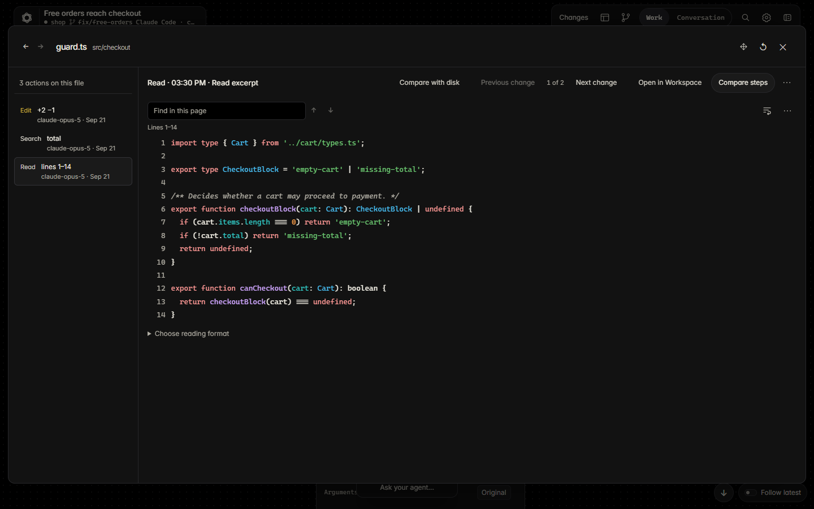
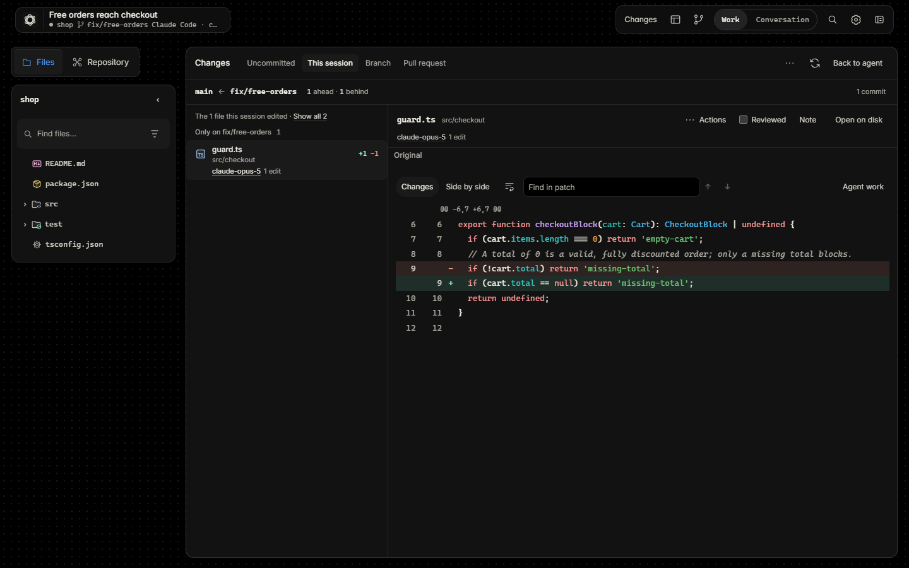

<p align="center">
  <picture>
    <source media="(prefers-color-scheme: dark)" srcset="docs/readme/mark-on-dark.svg">
    
  </picture>
</p>

<h1 align="center">Drishya</h1>

<p align="center"><b>दृश्य</b> &nbsp;·&nbsp; <i>that which is seen</i></p>

<p align="center">
  <b>See what your coding agent is doing, and review it like an engineer.</b>
</p>

<p align="center">
  <a href="#install">Install</a> &nbsp;·&nbsp;
  <a href="#what-it-does">What it does</a> &nbsp;·&nbsp;
  <a href="#privacy-and-control">Privacy</a> &nbsp;·&nbsp;
  <a href="SECURITY.md">Security</a>
</p>

<p align="center">
  
  
</p>

<p align="center">
  
</p>

<p align="center"><sub>A synthetic session shipped with the repository. Every screenshot here is invented content.</sub></p>

Drishya is a local app that plays back, live or afterwards, what a coding agent did in your repository: the files it read, the searches and commands it ran, the output it got, the test that failed, the diff it wrote. It shows the captured material itself, not a summary, and puts the tools to review the change next to it. It supports **Claude Code**, **Codex** and **Antigravity**, and it runs entirely on your machine.

## The problem

An agent reads thirty files, runs ten commands, watches a test fail, edits two lines, and replies "Done". The change is yours to ship. The work behind it is a terminal scrollback you did not read, so you either trust it or spend twenty minutes reconstructing what happened.

Drishya keeps that work visible while it happens, and keeps the engineering tools in the same window.

| If this is your day | What Drishya does |
|---|---|
| **You vibe-code and do not read every line.** Code lands that nobody has read. | Watch each step as it happens: searches, file reads, commands, failures, edits. You see the real content, so even a change you never read leaves a trail you can follow. |
| **You cannot see what the agent explored.** It looked at dozens of files; you get one sentence. | Every step in order, with the output it got back, so you can see what it looked at before it decided. |
| **You cannot reason alongside it.** To judge its plan you need what it saw. | Open the file it is reading beside its work, with that file's earlier changes. Answer its questions in place, and send the next prompt to a Claude Code or Codex session. |
| **Review is scattered** across the terminal, an editor, a Git client and GitHub. | Workspace, Changes, the Git graph and search live in one window, next to the agent's work. |
| **Every agent keeps its own history,** and old sessions are hard to review. | Claude Code, Codex and Antigravity sessions on one Home. Replay any of them, read it as Work or as Conversation, and search it. |
| **Your code should not leave your machine** to be understood. | Local only. No telemetry. Secrets are redacted before anything is stored. |

## What it does

**Live view and replay.** Open a session and steps appear as the agent takes them, each shaped for what it is: a read shows the source, a command shows its output, a test run shows its cases, an edit shows the diff. Earlier work settles back but stays readable. Open a finished session and replay it at your own pace, or switch between **Work** (the actions) and **Conversation** (the prompts and replies). Large sessions open from the latest work first and finish loading in the background.

**Read along.** The Files tree marks what the agent touched. Open any file beside the agent's work and see every captured action on it (reads, searches, edits) with the diff of each edit, and compare any of those steps with the file on disk.

**Ask and steer.** For Claude Code and Codex, the composer can send the next prompt to a session you choose. It needs your consent for that checkout first. Drishya runs your own installed `claude` or `codex` to resume the session, can interrupt a turn it started, and shows the agent's questions and approval requests so you can answer them in place. It never attaches to a terminal that is already running, and the agent's own sandbox and approval rules stay in charge.

**Review like an engineer.**

- **Workspace** is a full reading view for the code: up to eight file tabs, find in file, and local drafts that stay in memory (Drishya never writes to your repository).
- **Changes** compares two sides: uncommitted changes, what this session changed, one branch against another, or a pull request against its base. Files changed on both sides come first, since those are where a merge can conflict. Each file shows which sessions and agents edited it. Mark files reviewed, leave notes, and save a redacted handoff of what you reviewed. It is read-only: no fetch, checkout or merge.
- **Git graph** shows branches, tags and commits, and links a commit to the session that made it where the record shows it.
- **Search** covers the session you are reading, the files Drishya has indexed, and your other imported sessions.

<table>
  <tr>
    <td width="50%"></td>
    <td width="50%"></td>
  </tr>
  <tr>
    <td align="center"><sub>A file with every action on it</sub></td>
    <td align="center"><sub>Changes, with the agent behind each file</sub></td>
  </tr>
</table>

Drishya shows what a harness recorded and says so when it recorded nothing. Where an agent's reasoning was not written to its journal, the interface reads "Reasoning not recorded" instead of guessing.

## Supported agents

| | Live view | Replay | Send a prompt from Drishya |
|---|:---:|:---:|:---:|
| **Claude Code** | Yes | Yes | Yes |
| **Codex** | Yes | Yes | Yes |
| **Antigravity** | Not in this release | Yes | No |

Drishya finds sessions where each agent already writes them, and only reads them.

- **Claude Code:** `~/.claude/projects`
- **Codex:** `~/.codex/sessions`
- **Antigravity:** the transcripts under `~/.gemini/antigravity`. Antigravity support is the newest and has had the least real-world use. It is read-only: Drishya never starts or steers an Antigravity session.

Each location can be overridden with `DRISHYA_CLAUDE_HOME`, `DRISHYA_CODEX_HOME` (or `CODEX_HOME`) and `DRISHYA_ANTIGRAVITY_HOME`. Agent journals are not a documented, stable format, so a harness update can outrun Drishya; unknown records are shown as unknown rather than guessed.

## Install

**Requirements**

- **Node.js 24** (`>=24 <25`). Drishya uses Node's built-in SQLite and has no runtime dependencies.
- A desktop browser, at least 600 px wide.
- `git`, for Files and Changes. The GitHub CLI (`gh`) is optional, for pull requests.
- To send prompts: the `claude` or `codex` command already installed and signed in.

Drishya is built and tested on Windows 11. It is plain Node with no native add-ons and should run on Linux and macOS, but those have not been verified yet.

### From source

This works today.

```bash
git clone https://github.com/drishya-dev/drishya.git
cd drishya
corepack pnpm install --frozen-lockfile
corepack pnpm ui:build
corepack pnpm serve
```

`corepack` ships with Node and fetches the pnpm version this repository pins. Rebuild the UI (`corepack pnpm ui:build`) after every update.

### From npm (at launch)

The package is not published yet. When it is, it will be:

```bash
npm install -g @drishya-dev/cli
drishya serve
```

### First run

1. `serve` prints a link and opens it in your browser. If the browser does not open, copy the link from the terminal. It carries a random token, new on every launch, that keeps other websites from reading your sessions.
2. **Home** lists the sessions Drishya finds for your agents. Open one. A session is imported when you first open it.
3. Open a recent session to follow it live, or an older one to replay it. In the Files rail, choose **Enable workspace reading** to let Drishya read the repository's current files. It asks once per checkout and never writes to it.
4. No sessions yet? Open `http://127.0.0.1:7878/?demo` for a synthetic sample that needs no agent.

Stop it with Ctrl+C. The default port is 7878; use `--port` if it is taken. A restart prints a new link.

<details>
<summary><b>Command line</b></summary>

<br>

With the npm install use `drishya <command>`. From a checkout use `corepack pnpm drishya <command>`.

| Command | What it does |
|---|---|
| `serve [--port 7878] [--no-open]` | Start the app. |
| `sources [--json]` | List the sessions found on this machine. |
| `import <path>` | Import one session journal; the agent is detected for you. |
| `import --latest [claude-code\|codex]` | Import the most recent session. |
| `list` | List imported recordings. |
| `export <recording> --out <file>` | Write a sanitized replay bundle. |
| `forget <recording>` | Remove a recording from the local store. |
| `storage` | Show how much disk the store uses against a 10 GiB advisory budget. Nothing is deleted automatically. |

</details>

### Uninstall

Drishya changes nothing outside its own data directory, so removing it is three steps.

1. Stop it (Ctrl+C).
2. Delete its data directory: `~/.drishya` (`%USERPROFILE%\.drishya` on Windows), or the folder `DRISHYA_HOME` points to. It holds the database, stored content and indexes.
3. Remove the program: delete your checkout, or `npm uninstall -g @drishya-dev/cli`.

To remove one session and keep the rest, use `drishya forget <recording>`. Your agents' journals and your repositories are never modified by Drishya, so there is nothing to restore. Display preferences kept by the page in your browser can be cleared with the site data for `127.0.0.1:7878`.

## Privacy and control

Drishya sits next to your repositories and your agents' journals, so what it does with them is stated plainly here. The code behind each statement is covered by the security suite (`pnpm test:security`).

- **It reads** your agents' journals (locations above), read-only, and the repositories you grant. A repository's files are read only after you choose **Enable workspace reading** for it, and its Git data through fixed `git` commands with no shell. The only time an agent's journal is written is when you resume that session from Drishya's composer: your own `claude` or `codex` then writes it, as it always does.
- **It stores** redacted copies of what it imports, under `~/.drishya` (or `DRISHYA_HOME`): a SQLite database, content files and search indexes. It writes nothing to your repositories or your agents' folders. `drishya storage` shows the size and `drishya forget` removes a recording.
- **It sends nothing.** There is no telemetry, analytics, crash reporting or update check, and no opt-out because there is nothing to opt out of. The page loads no fonts, scripts or images from other hosts. The security suite records every network connection the server makes while it walks every screen, and the packaged build is checked the same way at start-up: all of them stay on loopback.
- **It listens on `127.0.0.1` only,** by default on port 7878. It refuses to bind anything else, and it checks the `Host` and `Origin` of every request. The launch link carries a random token that is exchanged for an `HttpOnly`, `SameSite=Strict` cookie.
- **Secrets are redacted before they are stored,** not afterwards: private keys, common provider tokens, JWTs, bearer tokens, URL credentials and high-entropy assignments, and the contents of protected files such as `.env` and key files. Redaction is best effort, not a guarantee. If you find a pattern it misses, that is a useful report.
- **Two things are opt-in.** The optional GitHub integration (Settings) runs your own signed-in `gh` to show pull request details and to compare a pull request; while it is off, `gh` is never run. Sending a prompt runs your own `claude` or `codex`, which talk to their own services as they always do.

> [!WARNING]
> **Do not expose Drishya's port to a network.** Do not put it behind a reverse proxy or a tunnel, and do not forward it (VS Code, SSH, WSL or Docker port forwarding). Drishya is built to be reached only from your own machine: it binds to loopback and refuses requests for any other host name. Forwarding or proxying the port works against that design, and anyone who obtains the launch link could read your sessions and, if you have enabled prompting, send prompts to your agents. Drishya cannot detect this, and a report that depends on it is out of scope.

To report a vulnerability, follow [SECURITY.md](SECURITY.md) and use GitHub's private report rather than a public issue. Known limits and what has been tested are in the [threat model](docs/review/sec-3-threat-model.md).

## Develop

```bash
corepack pnpm install --frozen-lockfile
corepack pnpm ui:dev            # the UI with hot reload
corepack pnpm dev               # the daemon, in development mode
corepack pnpm check             # typecheck and unit tests
corepack pnpm test:security     # the security suite
corepack pnpm test:browser      # builds the UI and runs the browser suite
corepack pnpm package:verify    # builds the npm package, checks its contents, installs it offline
```

The backend is TypeScript run directly on Node 24 over `node:sqlite` and `node:http`, with a React 19 and Vite front end; there is no build step for the daemon. [docs/CODEBASE.md](docs/CODEBASE.md) maps the packages and how to add an agent. Read [CONTRIBUTING.md](CONTRIBUTING.md) before opening a pull request.

## License

Drishya is released under the [Apache License 2.0](LICENSE).
