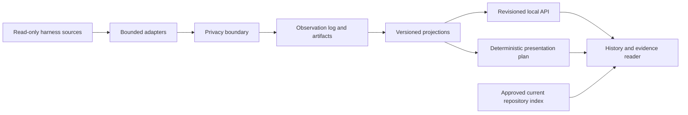

# Implementation roadmap — trustworthy baseline before premium expansion

**10 October product refinement sequence:** [41](review/41-developer-angles-and-reading-plan.md) defines R1–R6 after firsthand independent critique. Start with evidence entry/useful previews and coherent reading, then meaningful repository focus, account-specific native acceptance, read-only Git review/progress and handoff. Reuse global paged evidence services; do not regress B4 or replace the core stack. Real native acceptance is a release prerequisite alongside UI work, not proof inferred from synthetic reviewers. The original B/P/E gates below remain engineering history and release boundaries.

**7 October amendment:** [Connected workspace](review/26-connected-workspace.md) implements session folders/current-file reading and an explicitly authorized opt-in native prompt controller. This supersedes older observe-only product scope while preserving passive capture, privacy/evidence boundaries and publishing-only CI. No event/store schema or runtime dependency changed.

**30 September 2026.** Execution plan for the builder's backend-first direction. The backend is a functioning **draft**, not a completed production substrate. See the [measured baseline and findings](review/06-baseline-audit.md). This document supersedes the older “frontend pass next” queue. It supplements the [engineering architecture](review/03-engineering-plan.md); contracts below remain proposals requiring the existing two-builder agreement where they change the event schema.

## 1. Keep the architecture, strengthen its boundaries

Keep TypeScript/Node 24, SQLite, content-addressed blobs, loopback HTTP/SSE, React/Vite and a pure composer. The architecture already separates useful responsibilities. A wholesale rewrite would discard working parsers, provenance rules and tests without resolving the main gaps.



This is the target flow; “revisioned” recovery, bounded history APIs and the presentation plan are not implemented yet. Capture must function with the browser closed, while the user reads old history, and while the map is disabled. Current indexing is labelled current, never the historical repository state.

SQLite/CPU-heavy reduction move behind workers before large-session launch. First establish measurements and a single ownership protocol for writes/shutdown, rather than introducing worker races piecemeal. Preserve backend zero-runtime-dependency benefits where practical. Add CodeMirror for a bounded reader; Pixi for a bounded map after history correctness. Tree-sitter extraction should improve a verified set of relationships, not become an attempt to infer the entire runtime architecture.

## 2. Work packages and exit gates

Each row should become a small reviewable PR or closely related sequence. Do not combine all of these into one rewrite. Both builders review contract changes before the dependent work lands.

| Order | Deliverable | Exit evidence |
|---|---|---|
| B0 | Close privacy bypasses and define the actual privacy boundary | Synthetic canaries absent from every persisted/indexed/exported/rendered sink; known failures in audit become regression tests |
| B1 | Capture lifecycle and local API recovery | Restart, partial line, rotation, deletion, slow tail, reconnect and concurrent requests have explicit bounded behavior |
| B2 | Stable history identity and historical correctness | Late results/companions do not lose anchors; same-path worktrees remain separate; historical views never expose later results |
| B3 | Integrated base UI with session choice and independent reading position | Choose local session, follow updates, scroll back/select/read while new work accumulates, recover connection, return to latest |
| B4 | Large-session and installation gates | Recorded benchmark matrix, bounded resources, clean packed install on supported systems, offline core use |
| P1 | Content-shaped renderers and five crafted transitions | Freeze/truth/ten-minute tests at multiple widths, keyboard/reduced-motion parity, bounded burst behavior |
| P2 | Since-last-visit plus file history and verification freshness | Evidence-linked tasks improve in a small pilot; no misleading verification claims |
| E1 | Further harnesses and review packets | Versioned compatibility corpus, passive capture proven, export privacy review, no baseline regression |

Nemotron or another explanation service is optional and does not block B0–B4. A model key is not required to build or validate the core product. The live remote explain integration remains unverified. Harden consent before sending real evidence, then validate separately with an explicitly configured service.

**6 October product delivery amendment:** the builder now requests the finished integrated local product rather than more standalone studies. [PRODUCT_DELIVERY](PRODUCT_DELIVERY.md) describes the shared production workspace, settings/themes, P2-B file evidence comparison and run/package flows. P1/P2 implementation is the current baseline; human comprehension/preference and physical/platform release checks remain acceptance work. Further colour/motion refinement proceeds in `apps/ui`, retaining truthful origins and bounded history.

**P1 implementation amendment (5 Oct):** the [P1 record](review/09-p1-content-origins.md) describes the implemented repository lens, evidence-matched origins, material readers and five semantic cues. Engineering acceptance does not freeze the art direction. The builder's latest standard rejects a decorated transcript; retain useful spatial relationships, capture honesty and reader agency while refining theme/colour/composition. P2-A reading marks are already merged via PR #21, with whole-recording worker facts. Remaining P2 work is file-centred comparison/history, qualified verification freshness and a human comprehension/preference pilot.

## 3. B0 — privacy and trust are release blockers

> **Progress, 2 Oct: B0 complete (policy `p3`).** A01, the A02 sinks, A03 multi-root export, A04 digest-bound consent, protected-file scopes (including shell/patch routes), safe forget and the outdated-policy flag are implemented with regression tests. See STATUS.

The existing redactor handles ordinary supported token patterns and protected-file content, and tests verify selected store/search paths. The audit nevertheless reproduced a `base64`-object sibling bypass and unsanitized object keys. It also found metadata/sink coverage gaps in source review. This is a bounded hardening task, not a promise that regex detection can identify every secret.

Implement a recursive sanitation policy that covers all retained text, including object keys and metadata. When redacting keys, define collision behavior without silently overwriting fields; avoid retaining original keys in redaction diagnostics. Redact complete bounded input before preview truncation, or use a deliberately conservative boundary omission policy. Image removal must still recurse into every retained sibling. For protected paths, test nested, unknown and primitive result shapes rather than relying only on a small key allowlist.

Inventory sinks explicitly: observations and envelope metadata; recording titles; source discovery metadata shown in UI; blob content; projections; FTS; graph labels; bookmarks; cached explanations; export payloads; diagnostic logs; error responses. Define which local paths are deliberately visible in local UI, and which must be removed from export. Do not confuse privacy redaction with HTML escaping. Render untrusted text safely and prohibit active HTML in tool output.

Tests plant synthetic secrets in ordinary fields, nested arrays, map keys, image siblings, long strings at truncation boundaries, branch names, tool ids, malformed-record diagnostics and user-authored notes. Exercise store/WAL/blob/search/export/HTTP errors, and verify secret absence in bytes as well as parsed objects. Validate failure paths and memory/resource caps. Never commit real recordings or real secrets as regression fixtures.

Exports need a full multi-recording path/identity policy: all workspace roots, worktrees and sources, not only the first recording's root. Bundle metadata must represent the whole selection. An export preview must expose omissions and selected content. Consent for remote explanation binds to an immutable evidence revision, exact payload digest, model and destination; a changed live projection requires a new preview. Generated output is sanitized and labelled too. Valid citations are necessary but do not prove a claim follows from the evidence.

“Forget recording” needs cancellation/await of ingest, transactional metadata removal, blob reference accounting, and documented retention. Garbage collection must preserve blobs shared by other recordings and be recoverable until deletion is confirmed. Do not promise forensic disk erasure from deleting a SQLite row. Keep all validation local; use in-memory real-session diagnostics until known persistence bypasses are fixed.

## 4. B1 — reliable collection and recovery

> **Progress, 3 Oct: B1 complete.** Capture lifecycle (health states with codes, discovery errors, coalesced bounded live turns, `import --live`) and recovery (revisions committed with data, SSE `sync` on every connection, slow-subscriber cap, session lifetime/cap/sign-out, bounded query params, UI stale-response guards). Open follow-up: signed-out detection after a daemon restart.

### Capture lifecycle

Introduce explicit states: discovered, importing, following, idle source, stopped, missing source, unsupported and failed. These describe observer/source status, not certainty that the underlying agent is alive. Surface permission failures separately from an empty list. A missing journal or parser exception produces a visible, sanitized diagnostic. The current server's swallowed ingest errors must be replaced with structured recording health.

Coalesce live ticks: at most one active read plus one pending wake-up per recording. Bound byte/record work per turn and yield between batches. Store cursor and observations atomically. New companion sources use the same privacy boundary. Test duplicate records, out-of-order records, late tool results, malformed/oversized lines, truncation/replacement, missing files, Windows rename behavior and shutdown while importing.

Define process-restart behavior: the daemon may remember selected sources, but resuming follow must revalidate paths/permissions and deduplicate from committed cursors. Do not silently start following every discovered session. Fix or remove the advertised CLI `import --live`: it currently closes the app without starting a live watcher.

### API and SSE

Add monotonically increasing **recording revisions** committed alongside derived changes. SSE is a notification channel; durable state remains queryable. Events carry recording identity and revision. Client reconnect sends its last known revision or requests current revision, then fetches missing changes or a bounded snapshot. A browser reconnect that receives no subsequent write must still converge to current state.

Bound subscriber buffers; slow/disconnected clients must not hold capture memory indefinitely. Disconnect or coalesce invalidations safely rather than enqueueing full content. Validate query bounds and identifiers; cap request body, response page size, artifact bytes and concurrent expensive work. Health/diagnostics must not leak raw source text.

For the local trust model, keep loopback binding, Host/Origin validation, JSON-only mutations and HttpOnly/SameSite cookies. Resolve the documented “one-time token” mismatch: either consume/revoke bootstrap tokens as intended or accurately document their launch-lifetime validity. Set session lifetime/revocation and avoid unbounded session sets. Test cross-origin and restart behavior. Do not add remote network access to solve deployment convenience.

Frontend requests carry selected-recording identity and revision; stale responses are discarded or aborted. Clear pending debounce callbacks on navigation/unmount. Cache keys include recording/projection/privacy policy and artifact revision, not only a convenient id. Failed fetches must be retryable. Offline/reconnecting states stay visible and never masquerade as an empty successful history.

## 5. B2 — identity, artifacts and honest history

**Implementation note (3 Oct):** A11–A13's core history corrections are implemented with synthetic tests: event-based passage IDs and reader offsets; per-recording reconstruction bases; worktree-qualified paths and captured-path maps for mixed roots; and a pure as-of projection through scene, renderer and model evidence. This does **not** close B2. The bounded artifact API, graph freshness/approval work and live/browser acceptance below remain gates.

**Update (4 Oct):** bounded artifact slices (sparse line index, 2 MiB cap, explicit availability and cut) and graph freshness/approval (approved roots only, `stale` from a walk-and-stat probe, explicit refresh, protected files never opened) are implemented with tests and a real-app check. Remaining B2 gate: live/browser anchor acceptance with opted-in real data.

**Synthetic browser gate (4 Oct):** an end-to-end Playwright test now appends 200 synthetic source records at each of 1440, 900 and 390 CSS px to a live daemon. It checks the same passage and pixel offset, new-work count, explicit return after scrolling to bottom, old captured content, map-off, reduced motion and browser reload. A manual five-burst run confirmed no duplicate re-import. The opted-in real-session repeat remains open; do not count synthetic coverage as real-data acceptance.

**B2 complete (4 Oct).** The same journey ran on opted-in real sessions via `tests/browser/b2-real.spec.ts`. Real-session result (4 Oct, Harsh's machine, opt-in): one finished Claude Code session (1,172 journal lines → 556 observations, 480 steps, 189 operations) and one finished Codex session (704 lines → 234 observations, 211 steps, 80 operations). Each was copied to a temp folder and grown in two live bursts; the reader anchor held at 1440 and 390 px, map-off held, an operation opened, a reconnect reloaded the same history, and a resync added nothing. 0 visible gaps; 2/2 passed twice. Only counts were reported; the copies and stores were deleted.

Agree stable keys for recording, source generation, native event, operation, passage and file identity. Separate **ingestion order** from **source time** and **display grouping**. A late record may refine a passage but cannot invalidate all later reading anchors. Store an anchor as a stable item id plus offset; resolve deleted/grouped items to a documented nearby fallback. Positional `psg_1` style grouping alone is insufficient for durable anchors.

File identity must include repository/worktree context, not just a relative path. Validate combined-session compatibility before merging. Unrelated worktrees can be compared explicitly, but must never share snapshot reconstruction state. Agent identity is namespaced to its source/session, and delegation requires explicit evidence.

A historical operation view needs an as-of artifact/result boundary. At a tool's start, render its invocation and only already-available evidence. At its result, reveal the output. Selecting it in an optional replay cannot consult the final projection and disclose later bytes. Add a synthetic “result comes later” assertion through composer **and renderer**, not just status goldens.

Artifact responses specify byte/line range, total available length, source capture bounds, truncation, redaction and historical availability. Support bounded range retrieval without reading/splitting a whole huge blob on every request. Missing blob is a visible unavailable state, not empty code. Keep patch intent, reconstructed snapshots and captured snapshots distinct. Model evidence packs obey the same as-of boundary.

Graph caches key by approved root and generation; show staleness, refresh deliberately, and invalidate after relevant changes. Pin layout while reading. Indexing scope is explicit, ignores protected/generated/vendor content appropriately, and never follows symlinks outside approval. The first graph is imports/files plus observed activity, not a proven execution pipeline. DB references remain references; no database-content integration in this phase.

## 6. B3 — one integrated base UI

**Implementation update (5 Oct, merged as PR #15):** The integrated UI now exposes content-shaped expansion inside accumulating passages, paged source/output/diff reading, bounded separate preview and full-material caches, chooser search and grouping, file/tool navigation and virtualized file rows. Synthetic browser tests cover long history, old material while new events arrive, responsive widths and reader controls. The B2 real-session acceptance evidence predates this change, so the B3 change is not a new real-session certification.

Use the existing app and API. Port the prototype's **behaviors**, not its synthetic timing implementation. No new frontend framework or second production UI is needed.

### State model, independent responsibilities

```text
capture: selectedSources, health, committedRevision
history: availableRevision, orderedStableItems, pageCursors
reader: anchorId + offset, followLatest, selection, expansion, filter
replay (optional): enabled, asOfPosition, playing, speed
map: approvedRoot, generation, camera, selection
```

This is a proposal for responsibilities, not a frozen TypeScript contract. Capture and history advance independently of reader/replay. Navigating into the past changes the reader, not `availableRevision`. End-of-history following uses the latest known state directly; it does not slowly replay a backlog through `dwellFor`.

**Follow rules:** follow only when already at the latest edge and not deliberately reading/selected. Scrolling up, text selection, expanding content, following a search result or map exploration detaches follow. Pointer movement does not. Show a bounded new-activity count. Explicit return restores latest and follow; do not auto-return because the user happened to scroll near the bottom inside a nested reader.

Virtualize passages by measured height with overscan, preserving selected/focused elements. Loading older pages keeps the previous anchor at the same pixel offset. Do not remount focused readers on every live revision. Collapsed previews and full material caches have separate budgets. Search and file navigation scroll to stable items without hiding later history. Closing a reader restores the exact context.

Session chooser: project/worktree grouping; harness, safe title, last source update, import/follow state and capability gaps; search and date filters; explicit select/follow; remembered local selection. Show local discovery scope before scanning/importing; account login is unnecessary. Source paths remain read-only. List errors and empty state separately. Combined view is opt-in and validated. UI must distinguish synthetic demo, imported recording and active local observer.

**Acceptance scenario:** with two synthetic harnesses and an appendable journal, open a session, scroll back, select/copy code, receive 200 new events, expand an old artifact, reconnect the browser, and return to latest. No lost events, anchor movement, duplicate imports, cross-session stale response, or involuntary scroll. Repeat at 1440, 900 and 390 CSS px; keyboard only; reduced motion; map off. Then repeat against opted-in real sessions after B0. Automated Playwright tests should target these behaviors rather than incidental markup.

## 7. B4 — provisional numeric gates

**Current amendment (5 Oct):** the builder resumed B4 optimization before premium expansion, superseding the earlier deferral. The [bounded history reader report](review/08-b4-history-reader.md) records the worker/index/page boundary, resource settings, storage/cleanup, offline packaging and measured results. Normal 5k-file map updates now have p95 278 ms with sampled peak RSS 403 MiB; five independent valid 1 GiB shell-output imports have p95 sampled peak RSS 486 MiB. The historical failures and initial measurements remain in [07](review/07-b4-scale-install.md). Physical low-resource/lower-core, real macOS/Linux and exact-change CI/review remain release gates. B4 is an engineering candidate, not broad-release certification.

These are **targets to measure**, not current achievements. Use a named reference machine (OS, CPU, RAM, browser, Node, power mode), cold/warm runs, at least five repetitions and p50/p95 where enough samples exist. Separate ingestion throughput from rendering frame time and retained storage. Never market the audit's four small in-memory timings as performance benchmarks.

| Workload / metric | Initial target | What to measure |
|---|---|---|
| Normal session | 10,000 observations, 5,000 eligible repo files | Full local import, paged history, search and navigation |
| Long session | 100,000 observations / 1 GiB source; 2 GiB adversarial source probe | Bounded reads, restart, no full-DOM/full-projection dependency |
| Burst | 2,000 observations in 30 seconds | Capture lag, duplicate/loss checks, rendering responsiveness |
| Typical visible latency | p95 under 1.5 s after a complete source record is readable, under normal load | Source flush → ingest commit → settled DOM, not provider token latency |
| Resource ceiling | Daemon RSS ≤512 MiB; browser JS heap ≤256 MiB for normal workload | Actual peak/steady state, separate GPU memory/whole browser RSS |
| Material cache | ≤64 MiB decoded text per browser; ≤12 mounted full readers | Bytes reserved for in-flight requests; true eviction, selected-reader exception surfaced |
| UI interaction | p95 response under 100 ms; target 60 Hz movement at reference desktop size | Long tasks, dropped frames, scrolling/selection under burst |
| Retention | 10 GiB advisory budget implemented, explicit disk usage and cleanup | Index/blob overhead, shared references, no silent deletion of selected recordings |
| Low-resource mode | Map off, motion off, smaller overscan/cache, same content/navigation | Run on integrated graphics / 8 GiB machine before claiming support |

Do not interpret “10 turns in RAM” literally: turns vary enormously in size. Budget bytes, mounted readers, graph nodes and queued work. Keep compact metadata and a disk-backed history index, materialize only visible/nearby content. In the map, begin with at most ~300 visible nodes and explicit expand/cluster controls; measure before raising it. Huge-repo fallbacks show the observed working set while indexing proceeds.

Passive capture overhead retest after the worker change: five rotated reference-machine runs measured observer −0.1%, observer+browser +2.7% median slowdown, with no lost/duplicate events. After the default poll moved from 750 ms to 500 ms (19 October, [107](review/107-investigation-finishing.md)) five rotated runs measured observer −0.4%, observer+browser +2.4%, 0 lost/duplicate. Lower-core hardware remains unverified. The <5% target is measured workload slowdown, never “zero overhead.” Keep unsupported scale claims out of release messaging and new UI work on the paged source/API boundary. Complete physical/platform validation before declaring the release gate closed.

**20 October actual-journal retest (PERF-1):** [Report and numeric samples](review/perf-1-large-journals.md) measure five fresh-process complete imports and five append/browser runs for each retained166/347/564MB Codex journal. All30 runs have zero adapter-reported gaps; all15 append runs match full-import IDs/order and a repeated sync adds nothing. This does not close DATA-1/2 typed-capture coverage. The largest complete-import peak is528.73MiB, beyond the512MiB reference screening budget; first-history indexing reaches6.82s. Append/browser requests and frame proxies show stalls (up to1.262s request,258ms frame gap). **The newly measured scale/resource gate is red: PERF-2 restores/retests budgets before new features or an explicitly agreed narrower support range.** Coordinate with DATA-1/2 claimed runtime files; retest after their merge. Warm OS cache, uncontrolled background development load and headless Edge proxies do not certify cold starts, actual human interaction, physical lower-resource hardware or other platforms. Historical synthetic passes above remain workload-specific.

## 8. Installation and user-side operation

### Today: developer checkout

The root package is private. Do **not** tell users `npx drishya` works as a published product. Current route: Node 24, the pinned pnpm version, install workspace dependencies, build UI, run `pnpm serve`, use the printed local launch URL, and select a discovered source. `pnpm dev` plus UI dev server is the development route. Verify exact commands against README and clean installs as the package evolves.

### Target: local package, then optional desktop shell

Prepare a distributable CLI package with backend source/workspace imports resolved, built UI assets, license and version manifest; verify the packed tarball in clean directories without repository symlinks. Node type stripping inside installed packages must be tested explicitly: source that runs in a workspace is not automatically a shippable npm package. If necessary compile backend to JS for distribution while keeping direct TS development; record that limited exception rather than assuming installation will work.

Release gate: clean Windows/macOS/Linux installation; supported Node check; first launch; browser authentication; discovery scope; one Claude and one Codex import; restart; offline core operation; uninstall/data-retention instructions. Use signed/checksummed artifacts where appropriate, CI provenance and tagged releases. A packaged runtime/desktop shell can reduce Node setup later. Tauri remains a later option, not a prerequisite for validating utility.

A public website hosts marketing and a synthetic/offline replay demo. It cannot automatically read local harness journals. The local daemon serves the real application and private data on loopback. No cloud storage, telemetry or login is necessary for the baseline. Publishing the marketing website, npm package and repository are separate release actions with their own readiness checks.

## 9. Harness expansion and consumer chat boundaries

Claude Code and Codex local journals are the immediate integration path already implemented. Publish adapter version/capability tables, tested fixture versions, gaps, and limitations. Exposed rationale depends on the source; “maximum detail” means maximum **available captured** detail, never guaranteed internal thinking. Source retention is controlled by the originating harness; copy approved sanitized artifacts into Drishya's store for durability.

Claude's documentation describes local data/session storage, supporting the local-first approach. Validate formats with compatibility fixtures rather than treating undocumented fields as a stable contract. [Claude local directory](https://code.claude.com/docs/en/claude-directory).

Codex app-server documents `thread/read` for stored history without resuming a thread. Investigate an explicitly read-only adapter, but do not assume it passively subscribes to any separately running Codex process. Local journal tailing stays the baseline until attachment semantics and overhead are proven. [Codex app-server](https://learn.chatgpt.com/docs/app-server).

**ChatGPT consumer chats, Claude consumer chats, Claude Code journals and Codex journals are different integration targets.** OpenAI's Conversations API stores conversation state used with Responses; that documentation is not evidence of access to a user's consumer ChatGPT chat archive. No generic supported live archive connector for arbitrary consumer ChatGPT/Claude sessions was verified in this review. [OpenAI conversation state](https://developers.openai.com/api/docs/guides/conversation-state).

For consumer chats, start with a separately researched, user-selected export importer if supported formats permit it. Label message-only imports clearly: no repository actions or file snapshots unless actually included. A future supported connector needs explicit user selection and its own privacy/capability contract. Do not scrape browser credentials or pretend the current desktop assistant's tools are capabilities distributable inside Drishya.

After B4, choose the next coding harness by pilot demand and passive source quality, not a logo checklist. For each candidate, first verify official capture surface, read-only/live semantics, session selection, versioning, available artifacts and privacy. Build a synthetic compatibility corpus, implement one vertical read→edit→test journey, then broaden support. Do not advertise universal coverage from one generic JSON parser.

## 10. First concrete implementation session

The original 30 September starting task was B0 privacy hardening. That work is completed; do not reopen it from this historical audit wording. Read [CONTINUITY](CONTINUITY.md), [STATUS](STATUS.md) and [PRODUCT_DELIVERY](PRODUCT_DELIVERY.md) for the current integrated baseline. Preserve its privacy regressions and bounded worker/data-source boundary while refining the real UI, then execute the remaining human/physical/platform acceptance. New capture formats or remote-provider validation remain separate scoped work.

**6 October P1 implementation amendment:** [23](review/23-p1-material-pacing.md) completes the integrated material/pacing scope on codex/ink-presentation: five slower finite moves, real origins, actual source-ready unfolding, content-shaped bounded readers, stable rows/prose, and a camera hold for delayed large results. STATUS carries local acceptance. This does not claim human visual approval or replace physical/platform/publishing gates. Proposed folder/symbol/tab features remain separate workspace phases; do not keep relabelling them as missing P1 animation work.

## 11. Delivery tags and planning ranges (3 October 2026)

These are **planning ranges, not promises**. Assume two builders working consistently, existing Claude/Codex scope, synthetic and opted-in real acceptance, and no new harness or theme variants before the baseline release. The backend reaches a product-level candidate after B4; the frontend reaches a strong product-level candidate after P1/P2 validation.

| Tag | One-line deliverable | Focused elapsed range |
|---|---|---|
| **B2-R** | Finish bounded historical artifact reads, graph freshness and live/browser anchor acceptance. | 1–2 weeks |
| **B3** | Make long live history, selection, search and optional replay reliably readable across viewport sizes. | 2–4 weeks |
| **B4** | Meet measured resource/capture gates and ship a tested local install on Windows, macOS and Linux. | 3–5 weeks |
| **P1** | Replace the base visual system with content-shaped surfaces, true origins and the five restrained signature moves. | 4–6 weeks |
| **P2** | Deliver since-last-visit, file history and verification freshness, then test comprehension with real users. | 3–5 weeks |
| **R1** | Accessibility, privacy and release polish; public demo, packaging and launch readiness. | 2–3 weeks |

With overlapping work, **roughly 12–18 calendar weeks for two full-time builders** from this baseline to a credible product beta is a working estimate; solo or part-time work takes longer. Re-estimate after B4 measured gates and the first user comprehension study. Additional harnesses, consumer-chat import, model enrichment and theme variants are separate later tracks.
