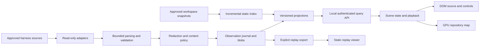

# Drishya: engineering, integration and delivery plan

**7 October amendment:** [Connected workspace](26-connected-workspace.md) implements session folders/current-file reading and an explicitly authorized opt-in native prompt controller. This supersedes older observe-only product scope while preserving passive capture, privacy/evidence boundaries and publishing-only CI. No event/store schema or runtime dependency changed.

> **5 Oct implementation amendment:** [08: bounded history reader](08-b4-history-reader.md) is current for worker ownership, streaming/indexed history, internal reader APIs and measured release limits. Earlier full-projection and deferral statements below are historical.


21 September 2026 · Proposed architecture amendments and build gates

> **30 September amendment:** [IMPLEMENTATION_ROADMAP](../IMPLEMENTATION_ROADMAP.md) governs current execution order and reliability/live-history/deployment amendments. [Baseline audit](06-baseline-audit.md) distinguishes built behavior from verified results and open defects. The built stack uses `node:sqlite` and `node:http` + SSE; see CODEBASE/STATUS for the recorded deviations from the proposal below. Live history accumulates independently of reading position; playback is optional. Schema proposals still require both builders' agreement.

This plan preserves a local browser application and an independent collector. It narrows the first implementation while making historical replay, privacy and performance explicit. It is not an implemented architecture. Schema changes below are proposals to reconcile with [reference 03](../reference/03-event-schema.md) before its first stable version.

## 1. Application form and stack

**Ship a local browser UI served by a local Node daemon first.** A static hosted demo uses an intentionally prepared replay bundle. The installed product reads approved local sources; the public site does not attempt to discover or connect to localhost. Keep one rendering codebase for both.

| Area | Initial choice | Reason and constraint |
|---|---|---|
| Runtime | A pinned, tested Node 24 LTS patch | One runtime reduces packaging and fixture variability; see research ledger T sources |
| Workspace | TypeScript, pnpm workspaces | Shared contracts without requiring a heavyweight build platform |
| Local API | Fastify + WebSocket notifications + HTTP queries | Typed validation, explicit API boundaries; avoid unbounded event pushes |
| Storage | SQLite WAL, initially `better-sqlite3` in a dedicated worker | Keeps synchronous DB work off the capture/API event loop; clean-install gate is mandatory |
| Large content | Redacted content-addressed files with manifests | Paging and deduplication without putting large payloads in events |
| UI | React 19, Vite, TypeScript, Zustand | React manages semantic scene state; it does not own a state update per frame |
| Source/diffs | CodeMirror 6, read-only | Selectable source, virtualized long documents, explicit editor instance disposal |
| Graphics | PixiJS v8, WebGL2 | Custom scene grammar; graph-off fallback is independent of Pixi |
| Motion | CSS/WAAPI or Motion at surface boundaries | One clock and cancellation contract; one system owns each animated property |
| Parsing | `web-tree-sitter`, TS/JS first; Python next | Progressive syntax/indexing without mandatory native parser builds |
| Resolution | Explicit import resolvers; evaluate TS compiler APIs for TS semantics | Reuse a well-maintained semantic tool where it reduces incorrect custom inference |
| Graph | Compact persisted nodes/typed edges; graphology for bounded working sets | Do not load every symbol into a large object graph |
| Tests | Vitest, Playwright, adapter fixtures, replay goldens | Correctness, user interaction and release installability |

Choose exact library versions after the packaging spike; commit the lockfile. Node 22/Bun, alternate databases, Tauri and WebGPU are not simultaneous support promises. Tauri is a future packaging option to evaluate on real platforms, not a required v1.5 commitment. “Never Electron” is not needed as a permanent architectural principle; the current browser choice should stand on measured installation and rendering behavior.

`better-sqlite3` still needs a compatible binary. If the clean-install matrix fails, evaluate bundled runtime distribution or a tested database alternative before promising zero-compiler installation. Do not claim that using WASM for Tree-sitter solves all native dependencies. [Node releases](https://nodejs.org/en/about/previous-releases), [better-sqlite3 installation](https://github.com/WiseLibs/better-sqlite3).

## 2. System boundaries



The graph index is optional enrichment. Replay must work while indexing is absent, stale or disabled. The renderer receives neutral material/evidence/relationship models, not harness-specific conditionals. Adapter-specific labels and capability information arrive as data.

Proposed packages: `contracts`, `capture-core`, `adapter-claude`, `adapter-codex`, `store`, `indexer`, `projection`, `scene`, `ui`, and `cli`. Start with fewer physical packages if boundaries can be enforced through modules; do not build a plugin marketplace before two adapters work.

## 3. Replace one overloaded event with observations and projections

The current draft makes the adapter know graph confidence, salience, rows and evidence links at ingest time. These facts arrive at different times and have different certainty. Separate them.

### 3.1 Immutable observation envelope

Proposed fields, not a unilateral schema replacement:

```typescript
interface Observation {
  id: string;                 // stable source identity, not fresh import UUID
  recordingId: string;
  source: {
    adapterId: string;
    adapterVersion: string;
    harnessVersion?: string;
    sourceId: string;          // journal/file identity within approved scope
    generation: number;      // changes on truncation/replacement
    recordId?: string;
    byteOffset?: number;
    sequence?: number;
  };
  receivedSequence: number;    // append order in this recording
  sourceTime?: string;
  observedAt: string;
  workspaceId?: string;
  worktreeId?: string;
  branchRef?: string;
  agentId?: string;
  operationId?: string;
  phase?: 'start' | 'delta' | 'complete';
  kind: string;               // tolerate unknown kinds
  sanitizedPayload: unknown;
  artifactIds: string[];
  privacyPolicyVersion: string;
  availability: 'complete' | 'partial' | 'metadata-only' | 'unavailable';
}
```

Generate stable IDs from source namespace plus native record identity; when unavailable, use file generation plus record offset. Use an internal sequence for database locality. Do not use raw source-content hashes as public IDs when that could expose secret or low-entropy material.

Hook and transcript observations may describe the same operation. Preserve both inputs with stable IDs; correlate through native call IDs into one operation projection. A duplicate import adds no new observation. Do not collapse legitimate repeated commands simply because their text and timestamps match.

### 3.2 Derived projection

A versioned reducer builds operations, turns, presentation groups, artifact associations and graph links. It records its version and source observations. Late results and reclassification create a new projection revision; they do not rewrite the historical evidence.

```typescript
interface EvidenceLink {
  from: string;
  to: string;
  relation: 'tool-result' | 'explicit-reference' | 'same-artifact'
    | 'temporal-neighbor' | 'static-import' | 'static-call'
    | 'test-reference' | 'observed-write-overlap';
  basis: 'source-id' | 'captured-reference' | 'deterministic-rule' | 'heuristic';
  sourceObservationIds: string[];
  ruleVersion?: string;
  explanation: string;
}
```

Do not label temporal neighbors as causal parents. Explicit parent/child spawn relationships differ from tool-result links and inferred evidence relevance. A single causal parent cannot represent all three. Use a relation table; DAG-like navigation must not imply all associations form an execution DAG.

Rows/beats remain useful presentation groupings. Native batch membership is one grouping signal. Timing heuristics can suggest grouping but cannot establish parallel execution. Store intervals when available and allow overlap/ordering to be unknown.

Capabilities should become feature-level data: live lifecycle, chunked output, read content/ranges, patch intent, confirmed write, before snapshot, after snapshot, exposed rationale, delegation and replay. Each capability carries supported/partial/unavailable, tested versions and last successful fixture. Keep numbered levels only as a friendly summary.

### 3.3 Field provenance

A captured read may contain a derived title and an inferred map position. Labeling the whole event “captured” is insufficient. Provenance belongs to artifacts, derived fields and relationships, with a simple user-facing summary and inspectable details.

Unknown records are **not** an exception to privacy. Preserve only sanitized, bounded extras. If a structure cannot safely pass the configured privacy policy, keep safe metadata and an explicit omission marker. Unvalidated `_raw` must never bypass redaction into disk, FTS, logs or export.

## 4. Historical content: the essential engineering feature

An artifact identifies `(workspace, worktree, normalized path, version evidence, observed interval)`. It can contain a full snapshot, a range, a patch, a command output or metadata only. Store the exact captured excerpt after redaction, including whether line numbers were harness-added.

Availability is multidimensional: source completeness, truncation, redaction, missing spill file, retention expiry and reconstruction status. Distinguish “captured excerpt” from “full file”. A read of lines 40–90 cannot prove the surrounding bytes at that moment.

**Version reconstruction rules:**

1. Use a captured snapshot or captured full write when it is identified and temporally attributable.
2. Apply a patch only against a verified base. Check path, base digest, ranges and hunk context; if incompatible, retain the patch and mark reconstruction unavailable.
3. A pre-edit snapshot is not itself an after snapshot. Shell tools, generators, partial writes and concurrent agents may change files outside structured edit tools.
4. A filesystem watcher observes states after events; it does not establish which agent wrote them. Record uncertainty and observed interval.
5. A failed tool invocation may have partial side effects. Tool outcome and observed disk state are separate fields.
6. A current-workspace read is labeled current with its own timestamp. It never silently fills a historical gap.
7. Renames and deletions retain identity/history where evidence allows. Case sensitivity, drive letters, symlinks, UNC paths and worktrees require platform-aware normalization.

Redaction changes bytes. Record hashes for sanitized content; those hashes verify stored integrity, not equality to the original unredacted file or authenticity of its author. If redaction prevents exact patch application, show sanitized captured hunks and an unavailable reconstruction instead of claiming an exact diff.

Graph snapshots also need version identity. If an old graph cannot be reconstructed, show a clearly labeled current-map overlay or a historical file-only map. Do not use future imports to explain an earlier run as if they were known then.

## 5. Adapters and capture policy

### Initial adapters

**Claude Code:** transcript-first import and passive tailing, with explicitly approved spill/snapshot resolution. Add optional hook enrichment only for verified event gaps. The existing five-second HTTP example cannot be described as nonblocking. If background command delivery is selected, its helper must be silent, bounded and return no agent-control fields. See [H1–H2](04-research-ledger.md#integration-findings).

**Codex:** map a small version-pinned fixture early, then implement tolerant rollout import/tailing and evaluate documented background hooks. App Server access is conditional on a supported attachment arrangement; do not start/resume a new run to make observation possible. Show exposed summaries/text according to actual availability. See [H3–H4](04-research-ledger.md#integration-findings).

**Expansion order:** OpenCode's existing server/API is the leading next technical candidate, then Cursor and Gemini CLI as user demand warrants. Documented interfaces take precedence over private-store reverse engineering. Other harnesses get import-only support until live attachment is trustworthy. See [H5–H7](04-research-ledger.md#integration-findings).

### Read-only line

Adapters never alter harness transcripts, history, sessions, working source or agent decisions. Drishya neither launches agents nor acts as their model proxy. Optional future configuration installation is a separate user-invoked operation: present an exact diff, own only the inserted entries, preserve unrelated configuration, and detach only those entries. The first alpha can provide manual configuration without implementing mutation at all.

Observability helpers must return no permission decisions, extra context, rewritten tool arguments or replacement results. Silence/error behavior must be tested for each harness rather than assumed to be the same.

### Streaming, recovery and overload

- Track source identity, generation and last committed offset. Keep incomplete trailing records in a bounded buffer. Handle truncate, rotate, replace and rename distinctly.
- Reconcile after restart from a safe committed cursor; deduplicate by source identity. A skipped malformed record produces a visible capture gap, never silent success.
- A 2 GB session is not necessarily many small lines. Enforce a record-size ceiling and streaming tokenization or safe rejection. Never accumulate a giant JSON line in memory and then claim to be streaming.
- Redact before any durable spool. For oversized or unparseable content, keep a bounded safe metadata record and omission reason. Raw spill files are not permitted as a memory workaround.
- Keep capture queue capacity in bytes. On pressure, deprioritize indexing/render notifications first. If capture cannot be retained, expose the gap and reconcile from the original source when possible.
- File flush delays, hook delivery, database commit and UI presentation are separate latency measures.
- Never wait for the browser to acknowledge before allowing a harness helper to finish. A disconnected viewer does not stop recording.

“No impact” becomes a measurable overhead target, not an absolute physical claim. Shared CPU/disk can affect the coding agent even with passive tailing. Test with the agent running, not only synthetic producer loops.

## 6. Storage and local API

Proposed logical tables: `recordings`, `sources`, `source_cursors`, `observations`, `operations`, `artifact_versions`, `artifact_ranges`, `blobs`, `links`, `projection_revisions`, `graph_generations`, `graph_nodes`, `graph_edges`, `layouts`, `playback_checkpoints`, `bookmarks`, `review_state` and sanitized FTS indexes.

Use explicit transactions to commit observations and source offsets together. Write new sanitized blobs atomically before committing references; after a crash, orphan blobs can be reclaimed. A DB reference must never point to a half-written file. Rebuildable projections are distinct from irreplaceable captured observations.

Blob reference counts alone can drift across crashes and exports. Periodically reconcile references from manifests; retention removes entire unpinned recordings and later sweeps unreachable content. “Pinned” prevents deletion, not memory eviction. Stronger redaction policy changes must invalidate/reprocess searchable previews and exports under the application's control; already shared copies cannot be recalled.

Useful API boundaries:

```text
GET /v1/recordings
GET /v1/recordings/:id/events?after=:cursor&limit=:bounded
GET /v1/recordings/:id/scene?at=:cursor&projection=:version
GET /v1/operations/:id
GET /v1/artifacts/:id?startLine=:n&lineCount=:bounded
GET /v1/graph?generation=:id&focus=:node&depth=:bounded
GET /v1/search?recording=:id&q=:query&cursor=:cursor
WS  /v1/changes  -> small committed-cursor/status notifications
```

These are design routes, not deployed endpoints. Authenticated local POST endpoints can handle Drishya-only bookmarks, review state, retention and explicit export; they must not expose generic filesystem reads or agent control. Resolve opaque IDs server-side and enforce approved roots. URLs and query logs must not leak code or bearer tokens.

On reconnect, the browser asks for changes after its last committed cursor. If notification history is unavailable, fetch a fresh bounded scene. Do not transmit every historical payload on reconnect or put full content in a Zustand store.

## 7. Static analysis with honest limits

The initial graph is files and resolved imports. It already supports location, connected neighborhoods and a stable canvas. Runtime pipelines and precise cross-language calls are separate later features.

1. Enumerate approved source files using ignores; exclude dependencies, build output, generated/vendor trees and oversized/binary files by default.
2. Parse changed supported files; store symbols and source ranges. Release parser trees when no longer needed.
3. Resolve imports with configuration-aware rules. For TS, aliases, package exports and re-exports matter; evaluate existing compiler resolution rather than assuming name matching is enough.
4. Publish typed edges with resolution basis. Report unresolved edges, not fabricated targets.
5. Group at module/package level; semantic clustering is an experiment, not a mandatory first milestone. Provide meaningful fallback labels.
6. Maintain stable IDs and persisted layout. Recompute a local neighborhood after changes; large rearrangement is explicit.
7. Add one framework detector at a time with fixtures and measured precision. A BFS result is labeled static reachability, never execution order.

Do not declare calls “exact within a module”: dynamic dispatch and aliasing can exist there too. Do not interpret PageRank as business importance or change risk. It can inform label priority, while user focus and recent relevant activity usually matter more.

Evaluate precision separately by edge type, language and framework. Suggested gate: at least 95% precision on a manually checked supported-edge sample, accompanied by coverage/unresolved counts. High precision obtained by resolving almost nothing is not success. Use a documented diverse corpus and a seeded layout test. The chosen threshold is a proposed engineering gate, not a known achieved capability.

## 8. Frontend and scene execution

**User-directed composition update:** implement the [continuous canvas](../reference/04-continuous-canvas.md) as a sequence of stable passage/prose blocks. Each passage retains its tool operations left to right, with selection/overlap state; prose has its own unframed DOM block. Top agent anchors and right-side tool/MCP anchors feed a measured origin-to-destination animation layer. Do not implement the default as one replacing `currentArtifact` panel.

Virtualize offscreen blocks, preserve scroll anchors as outputs expand, and separate capture cursor, playback cursor, selected operation, map camera and history scroll position. Late tool results update their existing operation. The one-to-three editor budget below applies to expanded full readers, not to the number of lightweight retained previews visible in history.


Use three kinds of state: durable recording/projection data; transient playback/selection state; imperative frame state. React/Zustand updates selection and available material. Pixi and the motion layer interpolate frame state without React rerendering the tree at 60 Hz.

Suggested pipeline:

```text
bounded scene query
  -> immutable evidence view model
  -> reducer(playback state, user intent, capture notice)
  -> compose(view model, playback time, preferences, viewport, versions)
  -> semantic DOM + graph draw list + cancellable transitions
```

No wall clock inside `compose`. Dwell choices, grouping, layout seed, reducer version and viewport class are inputs. Golden tests assert semantic scene output rather than pixel-identical GPU output across devices.

Seek from the nearest checkpoint plus a bounded delta, not `events[0..i]` from the beginning. Start with checkpoints every 250 observations or 5 seconds of source time and tune from measurement. Stream only the selected artifact region and neighboring timeline metadata. Cancel obsolete fetches and reject out-of-order responses after rapid scrubbing.

One to three mounted read-only editors at a time. Cache text by bytes, dispose editor state and syntax work when evicted, revoke media URLs, and free GPU textures. Include accessible DOM labels for the limited visible graph nodes and a semantic timeline alternative. The map must not be the only route to evidence.

For performance, favor scrim opacity over multiple full-screen backdrop filters. Use a private/on-demand renderer clock; stop redraw when hidden or stationary. Handle GPU context loss by restoring scene from semantic state, with graph-off review still usable.

## 9. Performance contract, with measurement boundaries

All numbers below are **targets**, not verified capacity. Benchmark on at least a Windows 11 laptop with 16 GB RAM, integrated GPU and SSD, and a 16 GB Apple Silicon Mac. Record exact models, OS/browser versions, viewport and device scale in results. Add an 8 GB stress machine before claiming low-memory support.

| Budget | Initial acceptance target | Measurement |
|---|---|---|
| Common repo | 5,000 eligible source files | Record bytes, language mix, symbols and edges too |
| Large repo | 50,000 files browsable via progressive indexing | No promise to parse/render everything immediately |
| Session | 100k observations / 2 GB source file; 1M-observation stress fixture later | Lazy import/replay; include an oversized single record |
| First useful view | ≤2 s warm replay shell/selected scene | Do not require a completed global map |
| Cold index | Target ≤30 s for documented 5k-file fixture | Separate enumeration, parse, resolve and layout |
| Ingest processing | p95 ≤50 ms for normal bounded records after source availability | Excludes harness flush delay; oversized records get separate budget |
| Live awareness | p95 ≤250 ms from committed event to live indicator | Distinct from readable focal presentation |
| Focal live delay | Typical p95 ≤5 s below declared load envelope | Under overload show lag/grouping; no impossible absolute gate |
| Seek | p95 ≤300 ms warm / ≤1 s cold for selected bounded scene | End-to-end including artifact request and paint |
| Frame time | p95 ≤16.7 ms Balanced; ≤33.3 ms Efficient | Scripted realistic replay and scrub, not idle FPS |
| UI process target | ≤900 MB Balanced / ≤450 MB Efficient | Isolated browser baseline; report shared GPU attribution limitations |
| Daemon aggregate | ≤300 MB active / ≤150 MB idle | Include worker memory; avoid RSS double-counting shared worker pages |
| Capture buffers | ≤16 MiB initial target | Byte bound independent of turn count |
| Text/artifact hot cache | ≤96 MiB Balanced / ≤32 MiB Efficient initially | Decoded text, editor state and images also measured separately |
| Idle/background | No continuous animation when hidden | CPU and wakeups measured; capture remains independent |

Start indexing with one worker; increase only under idle budget, capped at two or half available logical cores, whichever is lower. OS priority controls are best effort and must be verified per platform. The old “half the cores” rule alone does not prevent interference.

A ten-turn preference is a locality hint, not a memory limit. One turn can contain hundreds of megabytes. Byte-based eviction wins, pinned artifacts remain on disk, and visible content can be reloaded. Disk storage gets a configurable cap (proposed 5 GiB default), user-visible use, 30-day unpinned retention and a never-delete-pinned rule; if pins consume the cap, explain the conflict before dropping new capture. No silent deletion of irreplaceable reviewed evidence.

## 10. Privacy and security from first import

The application observes sensitive source, commands and conversations. No telemetry, no runtime CDN dependencies, no account requirement, no automatic model calls. Optional future remote summaries are a separate explicit data-transfer workflow, not a hidden fallback.

- Root/session selection bounds discovery. Resolve symlinks/reparse points and reject paths outside authorized roots, including spill-file references supplied by transcripts.
- Bind loopback; use a per-launch token exchanged for a short-lived local session, strict Host/Origin validation and CSRF defenses. WebSocket upgrades enforce the same boundary. Use a separate limited ingestion credential for optional helpers.
- Do not render source Markdown/HTML/SVG as executable content. Sanitize Markdown, ignore scripts, disable automatic external images and do not execute terminal control/OSC sequences. Treat transcript text as data, never app instructions.
- Run redaction before journal, blob, temp, FTS, preview, export and diagnostic writes. Handle secrets split across streamed chunks using bounded buffering; if policy cannot safely decide, show metadata-only pending/omitted content. Pattern detection is best effort, never a guarantee that every secret is removed.
- Provide restrictive local filesystem permissions and a clear storage location. Local-first does not itself mean encrypted at rest; use OS disk protections and evaluate a separate encrypted store only if required by target users.
- Archives need path traversal, symlink, decompression-size and file-count limits. Imported bundles must not gain arbitrary file/network access.
- Retention and purge include blobs, indexes, previews and backups under application control. Externally shared copies and OS backups have separate lifecycles; do not promise remote recall.

Unknown payloads and images require especially conservative handling. Automatic text redaction cannot certify screenshots as safe. Exclude images from export by default until individually previewed. *(21 Oct, review125 D7 revised: inline image bytes are now kept within limits after a signature check; see TASKS CONTENT-1. Exports still leave them out.)*

## 11. Deployment, packaging and operations

### Installed product

The package contains built static assets and the local daemon. A user starts it explicitly; no background OS service or login startup in the first release. Closing the UI offers stop recording or continue locally; make the collector's lifecycle visible and do not infer that closing one tab should kill other sessions.

Support one declared Node/runtime matrix first. Test `npm pack` output and install the tarball on clean Windows x64, macOS arm64 and Linux x64 machines. Include native dependency loading, grammar assets, spaces/Unicode paths, long paths, occupied ports and offline startup after installation. Expand architectures only after CI and real-machine validation.

Release with checksums, dependency/license inventory, reproducible build instructions and an authenticated/provenance-capable publishing workflow. Use manual checks for updates initially; never replace binaries during an active recording. Database migrations need a backup/restore strategy and an old-reader compatibility policy. No recommendation here to bypass OS protection dialogs; signed desktop distribution is a later measured packaging project.

### Demo and documentation

Deploy a static replay viewer with synthetic or explicitly approved sanitized recordings. Use the same scene engine and a bundle-backed data interface. Host without collector credentials or private paths; apply a restrictive content policy and no automatic localhost probes. The demo should work without account, harness or backend service.

Distribution claims must list actual tested harness versions and capture limitations. A pretty demo is not proof the installable app has the same data fidelity.

### Failure operations

Provide local diagnostics showing adapter version, source cursor, parser gaps, dropped/omitted bytes, projection version, DB health and resource counters. Diagnostic export is opt-in, sanitized and previewable. A disconnected harness, stale index and failed recording are distinct states. Product telemetry remains absent.

## 12. Build sequence and tests

| Step | Concrete artifact | Required acceptance |
|---|---|---|
| 1 | Synthetic canonical fixture and five action scenes | Read/edit/test/explanation/gap render in normal and reduced motion |
| 2 | First privacy pipeline and observation journal | Secret markers absent from all persisted artifacts; unknown/oversized inputs safe |
| 3 | Claude recorded fixture plus small Codex fixture | IDs, operation pairing and capability gaps correct; same source yields same observations |
| 4 | Change story + timeline + historical Reader | Hunk-to-evidence, backwards seek, selection and missing snapshot cases pass |
| 5 | File/import map with stable layout | Linked artifact location works; map off preserves review |
| 6 | Passive live + persistence recovery | Partial lines, rotation, duplicate import, restart and viewer reconnect pass |
| 7 | Burst handling and performance harness | 2,000 events/30 s including critical burst remains bounded and honest |
| 8 | Second full adapter and multi-agent state | No harness branches in renderer; worktrees and late results distinguished |
| 9 | Replay export + packed install matrix | Sanitized bundle validates; clean installs and static viewer pass |
| 10 | User study and public alpha | Correctness/comprehension evidence supports further investment |

Tests that matter include failed edits with disk changes, a file modified after passing tests, graph-version mismatch, two agents writing one file, identical paths in two worktrees, missing spilled output, malformed timestamps, compaction, a lost hook, Unicode source, secret splits, malicious Markdown, a renamed source log and a multi-megabyte single record.

Visual tests should cover the actual graph on a fixed renderer/seed with reasonable tolerances and semantic checks. Masking the entire Terrain in every test leaves the central visual feature untested. Use semantic golden scenes for determinism and a smaller set of controlled image comparisons for visual regressions.

## 13. What must be settled before a schema freeze

1. Observation IDs, operation correlation and source-generation/cursor semantics.
2. Artifact availability/version model and patch reconstruction policy.
3. Typed evidence relationships and field-level provenance.
4. Feature capability matrix and fixture version metadata.
5. Append-only observation versus mutable/versioned projection contract.
6. Privacy behavior for unknown, oversized and chunked payloads.
7. Cursor/checkpoint API between storage and scene composition.

These are bounded design decisions, not a request to reopen the entire vision. They are what allows the visual product to remain accurate as its integrations and graphic sophistication grow.
