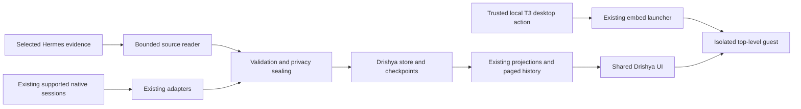

# Hermes Agent and T3 Code: proposed integration and delivery plan

**Status:** proposed; awaiting Yash's design review. **Date:** 19 November 2026. **Requested by:** Harsh Jain. **Scope of this PR:** documentation and review only.

This document proposes how Drishya can read Hermes sessions and run inside T3 Code while retaining one local capture, evidence and rendering system. It does not certify either integration, assign unaccepted implementation work, promise dates or authorize publication. Approval of this proposal opens the bounded feasibility work below; production implementation follows separate issues and reviewed PRs after the findings are accepted.

## 1. Decision requested

Yash: review the requirements, tradeoffs and stop conditions, then record approve, changes requested or defer against the decision table in section 12. Harsh's request to prepare this proposal is not recorded as both-builder agreement to any new schema or security exception.

Recommended order:
1. Audit and reuse the existing embed work; prove a T3 **local desktop** host prototype.
2. Prove Hermes import/replay against one explicitly selected genuine coding session.
3. Design and prove Hermes incremental live reading only after its source semantics are known.
4. Publish each capability independently when its acceptance evidence passes.

The four already-claimed MAP-3, UI-40, AG-3 and STORE-1 tasks retain their scope. Storage management helps support longer histories; it is not permission to mix those implementations into these PRs.

## 2. Evidence and claim boundaries

“Source-verified” below means documentation/code inspected, not installation or runtime acceptance. These revisions were resolved through GitHub on 19 November; future work must record installed release versions and fresh source pins.

| ID | Claim and evidence | What it does not establish |
|---|---|---|
| E1 | Hermes documents a local session database and a session export command. [Session documentation, pinned revision](https://github.com/NousResearch/hermes-agent/blob/fe8b920cae0980cef854f478236f525aaf2b93ce/website/docs/user-guide/sessions.md). | The installed user's format, historical file bytes or safe live interoperability. |
| E2 | The documented JSONL backup is one object per session and can include inactive/compacted messages; export has transcript-size guards. Same pinned document, “Export Sessions”. | Compatibility with Drishya's existing line-per-event reader, bounded export memory or an append-only change feed. |
| E3 | The pinned Hermes compatibility facade delegates reads to a persistence reader. [hermes_state.py](https://github.com/NousResearch/hermes-agent/blob/fe8b920cae0980cef854f478236f525aaf2b93ce/hermes_state.py). | A stable external SQL contract, fixed table names, immutable rows or support for every configured backend. |
| E4 | T3 describes controlling installed coding agents. [Pinned README](https://github.com/pingdotgg/t3code/blob/94baff19c6526a1bfa5ce2f9a2c37cbfb3703f31/README.md). | That every T3 thread has a supported native Drishya recording, or that a T3 thread ID equals a native session ID. |
| E5 | Its [PreviewPanel](https://github.com/pingdotgg/t3code/blob/94baff19c6526a1bfa5ce2f9a2c37cbfb3703f31/apps/web/src/components/preview/PreviewPanel.tsx) checks availability/access; [HostedBrowserWebview](https://github.com/pingdotgg/t3code/blob/94baff19c6526a1bfa5ce2f9a2c37cbfb3703f31/apps/web/src/browser/HostedBrowserWebview.tsx) and the [desktop manager](https://github.com/pingdotgg/t3code/blob/94baff19c6526a1bfa5ce2f9a2c37cbfb3703f31/apps/desktop/src/preview/Manager.ts) provide guest lifecycle code. | That the ordinary preview path protects Drishya credentials, excludes model automation, or is suitable without changes. No T3 runtime was tested here. |
| E6 | Drishya already has an agreed [EMBED-1 contract](embed-1-in-app.md). [PR #549](https://github.com/drishya-dev/drishya/pull/549), head `4787bd7f778b878da0c164870cd791ebeeb5a012`, was open and unmerged when checked. | That embed implementation is on main or that T3 maintainers have accepted an integration. |
| E7 | At Drishya main `30c83c9f71b7d0025c34927730d1c8bc5b5c1acc`, [Adapter](../../packages/capture-core/src/index.ts), [JSONL cursor](../../packages/capture-core/src/jsonl.ts) and [ingest](../../packages/ingest/src/index.ts) remain source/path and record-reader oriented. The JSONL default record cap is 16 MiB. | That a database containing many sessions can be registered as one existing journal, or that a large whole-session export fits this contract. |
| E8 | SQLite WAL supports snapshots, but long reads can delay checkpoint progress; read-only WAL access has side-file conditions. [SQLite WAL documentation](https://sqlite.org/wal.html). | Literal zero overhead, safe copying of only a running database's main file, or permission to mark a changing database immutable. |

Native Hermes and T3 runtime behaviour, supported version ranges, performance and physical platform coverage are **unverified in this proposal**. No marketplace, partnership, remote-access or universal compatibility claim follows from these sources. No external maintainer has been contacted.

## 3. Goals, non-goals and architecture

### Required outcomes

- A developer can select a supported Hermes coding session and understand the recorded work through existing History, map and readers.
- A local T3 desktop user can deliberately open the correct supported session in a Drishya guest view, preserve reading position and expand it.
- Adding a source reuses privacy sealing, store, projection, bounded history APIs and the existing UI.
- Unsupported data and host capabilities are explicit; partial support is named per capability.
- Capture continues independently of whether a pane is visible. No new agent API/model subscription is needed merely to replay already-recorded evidence.

### Outside the first scope

Hermes prompt control/approval handling; an agent orchestration service; remote/local-network tunnelling; phone clients; HTML iframe support; cloud recording upload; general chat/messaging import; a public third-party plugin marketplace; a second renderer; invented thoughts, file contents or causal links.

T3's ability to control an agent does not extend Drishya's own controller permissions. Existing supported controllers retain separate workspace consent and idle-client acknowledgement. Hermes remains passive in this scope.

### Architecture

T3 is initially a **host**, not another captured agent. Preserve the native agent identity and source provenance even when T3 launches it. An unsupported T3 provider must produce a clear unsupported-source result, not be relabelled Codex or Hermes.

### Approaches considered

| Approach | Benefit | Cost / decision |
|---|---|---|
| Existing T3 embed path; Hermes explicit export first; native incremental reading later | Small independently testable milestones; exposes evidence/identity gaps early | Recommended, subject to export-size and privacy feasibility gates. |
| Direct native Hermes database integration first | Potentially richer incremental access | Higher coupling to storage revisions, mutable messages, profiles, WAL and the source-reader seam. Investigate before committing to delivery. |
| A universal protocol/plugin SDK for both immediately | Attractive long-term extension story | Premature before these two different boundaries are proven; large compatibility/security surface. Revisit only after recurring needs are measured. |

A Hermes export is not a long-term live transport: repeatedly exporting a whole conversation would grow work with session size.

## 4. Shared requirements and identity

| ID | Requirement | Evidence needed before shipping |
|---|---|---|
| C1 | Native sources remain unmodified; no credential/config migration, repairs, checkpoint commands or writes initiated against Hermes/T3 stores. | File-access tests and a dedicated native write audit. |
| C2 | Seal/redact before Drishya persistence, blobs, previews, search, checkpoints, diagnostics and UI. No raw intermediate transcript in a Drishya-owned journal. | Seeded-secret tests across every persisted/visible output. |
| C3 | Stable identities and transactional cursor updates prevent duplicates after retry/crash; no content-hash identity for observations. | Repeated import, crash-boundary and restart equivalence tests. |
| C4 | Limits cover discovery, bytes, rows, connections, concurrent jobs and mounted content; cancellation closes resources. | Large-case measurements and tests proving limits, not just a fast demo. |
| C5 | Unknown formats/fields produce bounded diagnostics and honest missing-data states. Unknown metadata cannot bypass privacy. | Unsupported-version, malformed-input and unknown-kind tests. |
| C6 | Never read arbitrary paths from tool output; canonical containment and approved roots apply to artifacts/media. Missing historical bytes remain missing. | Traversal, symlink/reparse, replacement, protected-file and missing-artifact tests. |
| C7 | No telemetry; external model explanations, if separately enabled, keep existing explicit consent and generated labels. | Network/security regression checks. |
| C8 | Clear imported data through the established lifecycle; native sources and shared data survive. A forgotten session is not immediately re-created by a stale watcher. | STORE-1-compatible clear/watch/reimport tests. |

Identity needs a written feasibility result before implementation:

- **T3:** resolve environment + exact canonical checkout + provider + native session into an existing Drishya recording. A thread can change providers; decide which actual native segment(s) are represented. Do not merge different sessions by title or approximate timestamps.
- **Hermes:** namespace native session identity by verified local profile/store identity. One database can contain many sessions; its path alone cannot identify a recording. Never derive source IDs from message contents.
- **Exports:** unverified export metadata cannot claim another profile's live identity. Until an export is bound to a verified native source, keep it explicitly standalone and do not silently merge it with live capture.
- **Path changes:** Windows/WSL path spellings, worktrees, profile relocation, copied databases and replacement at the same path need explicit collision/reconciliation tests. Preserve existing recording IDs; a new alias mechanism requires reviewed migration and rollback rules.
- **Lineage:** compression, branching and subagent parentage are distinct. Use exact typed evidence; a generic parent ID alone does not prove a spawned agent.
- **Privacy of identity:** cursor/checkpoint values must be validated and sealed; never store credentials or unsanitized profile metadata as bookkeeping.

## 5. Track T: T3 Code desktop hosting

### User flow and thread selection

1. A deliberate **Open in Drishya** action runs in the trusted local desktop host.
2. It resolves the actual native recording and checkout. If exact identity is unavailable, offer explicit selection or a separately labelled “latest in this checkout” action. The latter must never pretend it is the clicked thread. No cross-checkout fallback.
3. The host invokes the installed launcher with an argument array, validates the response, and loads it privately into a dedicated top-level guest.
4. Drishya reuses the existing session view; resize/fullscreen preserves selection, replay position and reading anchor.
5. Missing installation/source, unsupported provider, authentication expiry or stopped daemon produces a specific retry/close/window fallback.

### Security and lifecycle requirements

The [EMBED-1 contract](embed-1-in-app.md) remains authoritative; this proposal adds no exception:

- Loopback and ephemeral ports; top-level Electron guest or browser window, never an iframe. Retain Host/Origin, JSON, CSP and cookie protections.
- Use private one-time launch handoff. No credential in model context, preview snapshots, server logs, persisted URLs, clipboard or screenshots. A cleaned URL alone is not a fresh login credential.
- Inspect actual guest preferences, preload, partition, navigation, downloads/popups, devtools capture and browser-automation attachments. Keep sandbox/context isolation, Node off and the minimum host bridge.
- Prefer a dedicated private desktop action/guest if ordinary T3 preview services persist or expose the URL. Source availability is not proof that their model-facing automation is safe for this authenticated view.
- The host owns only its spawned supervisor/child. Never discover-and-kill another daemon by PID or port. Repeated clicks deduplicate in-flight host work; separate invocations are not promised a global singleton.
- Hiding a view does not halt capture. On host/control-channel loss, follow the launcher contract for code invalidation and owned-child cleanup. Reopen/restart needs fresh authentication.
- MCP launch is optional. Use it only after proving this host excludes private metadata from model content, persistence and logs; otherwise use the private desktop or manual CLI path.
- Standalone acceptance remains 600/1440 px. The existing embed-only exception is 360 px on a desktop pane; no phone support is implied.

### Delivery and acceptance

- **T0 — dependency audit:** inspect the then-current #549 outcome and accepted guides; list existing functionality versus actual T3 gaps. No cherry-picking an unreviewed security implementation into a new integration branch.
- **T1 — local prototype:** on a pinned disposable T3 checkout, prove exact selection, private launch, navigation restrictions and guest lifecycle. No upstream publication/contact in this phase.
- **T2 — reviewable host patch:** produce a small local patch plus install/uninstall/version guide, packaged-install tests and compatibility matrix. Builders decide whether/when to approach T3 maintainers under their contribution policy.
- **T3 — acceptance:** genuine supported Claude Code, Codex and Antigravity sessions, live/replay at 360/600/1440; multiple sessions in the same checkout; provider switch; restart; expired/replayed launch; full screen/Escape; reduced motion; guest crash; host closure; missing session/daemon; unsupported remote/web clients; hostile navigation; secret-leak inspection. Exclude phone tests.

**Stop condition:** if credentials cannot be kept out of the host's stored/model-visible preview path, no integrated guest ships through that path. Retain explicit local-window launch until a private handoff is reviewed.

## 6. Track H: Hermes import, then bounded live capture

### H0 — establish the actual source contract

Use a genuine local coding task in a throwaway repository. Record installed version, profile/backend type and source shape without publishing content. Inspect:

- Native session/message identifiers, tool call/result correlation, ordering and available workspace identity.
- Message insertion versus in-place edit, rewind, compaction, pruning and profile/store replacement.
- Whether file bytes/diffs, images, running/final command output and child relationships are actually retained.
- Export selection, inactive-history flags, per-session memory/size limits and whether invoking export performs any native migrations or side effects.
- A supported read-only incremental interface, if one exists. Do not execute a Python compatibility facade inside the zero-dependency Node daemon.

Publish a capability matrix with captured/derived/unavailable status, sanitized synthetic fixtures and open questions. No SQL field or change-feed assumption is accepted until checked on the supported installed version.

### H1 — explicit import/replay milestone

- Accept only a deliberately selected, supported local export through a narrowly reviewed import/discovery path. Do not broaden the current import API to arbitrary client-supplied filesystem paths.
- Reject oversized records before unbounded allocation; the proposed first export range is at most the existing **16 MiB per source record** ceiling, subject to measured memory acceptance. Do not raise the cap to accommodate a whole-session backup. If this is insufficient for useful real cases, redesign bounded export/import before promising H1.
- Parse source envelopes separately from message-to-observation translation. Do not import a Hermes “Claude trace” export as native Claude evidence.
- Default to the recorded visible conversation. Detect and exclude inactive/rewound/compacted-away content according to verified semantics; if those flags cannot be interpreted safely, reject that variant. Archived-history support needs a separate explicit policy and replay design.
- Preserve tool calls/results and exact available file evidence. A present-day workspace file is not a historical snapshot. Derived tool classifications carry named provenance.
- Distinguish a captured timestamp from local import/observation time. Export timing summaries do not become measured tool durations or reasons for a change.
- Validate idempotence for the same source and declared standalone-export behaviour for copied/re-exported files. Any later native reconciliation is explicit and tested.

**H1 acceptance:** genuine bounded export imports; displayed counts/correlations match inspected evidence; unknown/malformed/oversized/private-history cases are honest; replay respects available history; repeat import adds no duplicates; redaction/export/clear round-trip passes. No live-support claim.

### H2 — native reader architecture decision

The current Adapter/SourceCursor expects a main journal and byte offsets. A multi-session database does not fit merely by implementing a parser. Submit a small internal source-reader design before implementation, covering:

- One verified native session per recording, logical row/revision cursor distinct from file byte offset, and transactionally committed sanitized inspection state.
- Bounded batches and cancellation, short database snapshots, connection ownership and no long read that pins Hermes WAL.
- Append plus edits/rewinds/compaction. A highest row ID alone cannot detect updates to old rows. Timestamps alone cannot establish a reliable cursor.
- A reliable change/version mechanism or bounded reconciliation with a measured total-work bound. If neither exists, retain import-only support instead of claiming complete live capture.
- Mutation handling that preserves Drishya's captured/derived boundary and truthful as-of replay. Do not rewrite old observations or manufacture old event times. Any needed observation/store contract change requires both-builder agreement.
- Schema/backend detection and fail-closed unsupported variants; no runtime dependency or opaque executable plugin loading.
- Consistent read-only access to live SQLite/WAL where applicable. No `immutable=1` on a changing source, main-file-only copy, native checkpoint, journal-mode change or repair. Verify whether read opening can create/modify side files; fail safely if the repo's no-native-writes boundary cannot be met. A consistent snapshot fallback needs separate validation and raw-data handling approval.

Reuse existing adapter helpers and checkpoint sealing where they fit. Do not implement a generic plugin SDK or force database offsets into the JSONL cursor to avoid an explicit design review.

### H3 — live/restart acceptance

Exercise appends, late tool results, same-row updates, equal timestamps, rewinds, compaction, pruning, crash before/after cursor commit, native restart, locked/missing/corrupt store, profile switch, file replacement and unknown source version.

Prove repeat/restart equivalence, no skipped supported changes, bounded work, truthful loss/gap states and reimport after clear. Media/subagents ship only if genuine cases prove containment/correlation. If a case cannot be generated with the available account, record it as blocked rather than fixture-proven.

## 7. Scale and performance

Scale has three separate budgets: adding more harnesses, handling larger sessions and following more simultaneous sessions. Local processing distributes work across users' machines; it does not prove good per-machine performance.

- Keep harness-specific translation at the edge; reuse neutral intents, privacy and shared rendering. Initially ship reviewed bundled adapters.
- Discover metadata lazily and follow only explicitly selected/imported sources. No unrestricted scan of Hermes messaging histories or every T3 environment.
- Use paged metadata/history/artifact reads, bounded queues, worker ownership and backpressure. Prioritise foreground reads without starving independent capture.
- No repeated whole-session exports or full-database scans per live poll. Document worst-case reconciliation work; unknown mutation semantics can block live delivery.
- Measure native-agent elapsed time, observer CPU/RSS, bytes/rows read, WAL growth, cold reopen and UI response. Compare observer-on/off under the same workload, versions and machine settings.
- Benchmark a small genuine session, a long genuine session, synthetic boundary cases, and 1/3/5 concurrently followed sessions. These are test points, not a promise of five-session support.
- Preserve current performance gates. H0/T1 must propose numeric budgets and a supported session/concurrency range from measurements; both builders accept them before implementation/release commitments. Any red existing gate blocks new feature scope unless a narrower supported range is explicitly recorded.
- Publish the measured range and platform limitations. No “zero overhead”, unlimited scalability or millions-of-sessions claim.

## 8. Failure and threat review

| Risk | Required behaviour / test |
|---|---|
| Wrong T3 thread or wrong repository | Exact identity or explicit selection; same-checkout concurrent-session and provider-switch tests. |
| Host/model reads the private launch URL | Private guest path; synthetic secret canary across logs, snapshots, tool results and navigation. Fail integration if it leaks. |
| Native database mutation or writer interference | Read-only/native-write audit and bounded snapshots; contention and WAL measurements. No repair fallback. |
| Existing messages change below a saved watermark | Verified change mechanism/reconciliation; otherwise live remains unsupported. |
| Huge export or malicious record | Pre-allocation limits, bounded diagnostics and cancellation; no cap increase without measured review. |
| Archived private chats enter a coding view | Explicit selected coding source and verified visibility flags; no automatic messaging discovery/import. |
| Forged artifact paths, symlinks or replaced files | Existing canonical containment/protected-path policy; no path-based arbitrary read or current-file substitution. |
| Interrupted import, disk full or source disappears | Last committed cursor stays valid; visible recoverable error; no partial success or silent history replacement. |
| Clearing while a watcher is active | Revoke/dispose through established lifecycle; preserve other sessions/native data and prevent resurrection. |
| Upstream update or unknown backend | Recognise supported shapes/versions, state unsupported, preserve existing recordings, allow rollback. |

A trusted same-user desktop host can already run local programs; Drishya does not claim to defeat a malicious privileged host. The integration still must avoid accidentally expanding its capabilities or exposing credentials to model tools.

## 9. Work packages, ownership and PR boundaries

All implementation owners below are **to be claimed after review**, not assigned by this proposal.

| Package | Deliverable | Depends on / exit |
|---|---|---|
| P0: design review | Yash/Harsh decisions recorded against section 12 | This docs PR; no runtime work. |
| P1: T3 feasibility | Pinned local prototype findings, exact-thread mapping and leak/lifecycle results | Current embed implementation reviewed; T1 stop condition resolved. |
| P2: Hermes feasibility | Genuine source/export capability matrix, identity/mutation/WAL findings and proposed budgets | Authorized local Hermes profile and throwaway task. Independent of P1. |
| P3: T3 host delivery | Focused host patch, guide and tested compatibility matrix | Accepted P1; upstream outreach remains builder-owned. |
| P4: Hermes import | Adapter/import-boundary changes, fixtures and genuine H1 acceptance | Accepted P2 and useful bounded export range. |
| P5: Hermes live | Reviewed source-reader seam, then live adapter/checkpoint changes | H2 decision and both-builder agreement to any schema change; H3 acceptance. |
| P6: release acceptance | Packaged tests, platform/security/performance evidence and release notes | Each capability can pass independently; incomplete ones remain experimental/unadvertised. |

Proposed code areas, **not files changed by this PR**:

- T3: verify #549's launcher/auth/MCP/runtime, bootstrap and embed view; existing `docs/guides/embed*.md` locations may only exist on that PR until merged. Host-side source areas are E5; exact IPC/preview patch follows T1.
- Hermes: a focused `packages/adapter-hermes/` following existing package conventions; the shared reader seam in `packages/capture-core/` and `packages/ingest/` only after H2; registration, CLI discovery/allowlisting and targeted privacy/security tests.
- Verification: adapter/ingest/store/daemon units, `scripts/real-cases/`, relevant browser/security specs and synthetic fixtures. UI-specific code stays small and capability-driven.
- Coordinate overlapping privacy/server/API/state files with #549, STORE-1 and other active PRs. No broad Settings, controller or rendering refactor.

Every implementation issue must copy its bounded requirements and acceptance IDs, identify supported versions, list dependencies, and use a draft PR while incomplete. Keep independent features in separate commits/PRs with agent co-author trailers. No automatic merge, tag or publish.

## 10. Verification and release gates

### For this proposal PR

Check citations at pinned revisions, repository paths, Markdown/local links, whitespace and requirement coverage. The docs-only PR needs no install, full test suite, native account access or package rebuild. No native acceptance is claimed.

### For subsequent implementation PRs

1. Reproduce each gap and add focused regression tests; run `pnpm check:affected`, touched-project typechecks and relevant unit/browser/security specs.
2. Use `pnpm check:real -- --list` and add applicable genuine-case helpers. Import only into scratch homes. When cases are absent, generate them with the genuine harness in a throwaway repository where the account is available.
3. Changes affecting shared rendered/projected content require real Claude Code and Codex cases as well as genuine Hermes/T3 cases. Check standalone 600/1440 and embed 360/600/1440 where applicable. Keep real screenshots/journals private in ignored `.local/`; publish prefixes, sizes, counts and outcomes only.
4. Run `pnpm package:verify` for completed capture/ingest/store/packaging changes. Test the installed tarball, not just source-tree imports, including runtime/dependency constraints.
5. Run one full gate per finished batch in an isolated worktree with its own frozen install: typecheck, units, UI build, full browser suite and package verification. Coordinate heavy runs on this average Windows machine; the previously measured three-worker configuration plus serial pass is not a universal performance guarantee. Record actual workers.
6. Record clean-main reproducible flakes and rerun alone per AGENTS.md; do not weaken assertions or claim baseline failure proves a changed code path safe.
7. Windows/Linux/macOS status is recorded separately. CI does not substitute for physical Mac acceptance. A narrower release range requires explicit maintainer acceptance.
8. Before promotion, verify install/upgrade/uninstall, source-version mismatch, rollback, storage clear/reimport, absence of leaked private data and existing harness regressions.

Acceptance evidence must name source/host/Drishya revisions, platform/runtime, covered case IDs, actual commands/outcomes and blocked items. Fixture-only evidence never closes a genuine acceptance line.

## 11. Rollout, compatibility and rollback

Use staged support labels: **research → experimental import → experimental live / host prototype → supported**, independently for each tested capability/version/platform. Existing recordings remain readable when a connector is disabled or its native source disappears.

No silent auto-update of external harnesses, no forced migration of their stores and no unreviewed schema rollout. If persistence changes are needed, document backward reads, crash-safe migration, downgrade limits and a user-owned backup plan before that PR. Test plugin/source disable and stale-view recovery.

Document exact tested versions and known limitations, with an opt-in local diagnostic report containing counts/versions only. Public issue reports must request synthetic/minimal reproductions rather than journals or credentials. Recheck compatibility with upstream releases through an agreed maintenance cadence; creating automated jobs or contacts is separate work.

## 12. Review decisions and unresolved questions

| Decision | Proposed answer | Review status |
|---|---|---|
| D1: scope/order | T3 local desktop hosting; Hermes selected coding-session import, then conditional live. | Pending Yash review |
| D2: existing embed/security contract | Reuse EMBED-1/#549, retain top-level guest/local-only boundaries and private handoff. | Pending confirmation that no new exception is needed |
| D3: Hermes evidence policy | Visible conversation by default; no messaging discovery, archived-history exposure, historical-byte invention or controller. | Pending Yash review |
| D4: architecture/compatibility | No public SDK; review source-reader/identity/mutation design after P2. Both builders approve schema changes separately. | Pending Yash review |
| D5: execution authorization | Approval opens P1/P2 feasibility issues only. Findings/budgets are reviewed before P3–P5 implementation. | Pending Yash review |
| D6: external coordination/release | Builders own T3/Hermes outreach and support promises; no release date or upstream acceptance assumed. | Pending Yash review |

Questions that feasibility must answer, not guesses to resolve by implementation:

- Can T3 expose exact native session segments and a private, non-model-visible guest handoff on a pinned desktop build?
- Which Hermes installed backend/export versions are safely readable without native writes, and what is the actual stable identity/change mechanism?
- Do useful genuine Hermes sessions fit a bounded explicit-export milestone, and what policy correctly handles visibility/compaction?
- What per-machine/session/concurrency budgets can both builders accept from the measured results?
- Which signed-in accounts and physical platforms are available for acceptance?

**Review completion:** each D row has a recorded decision or named blocker; requirements remain testable; no source claim is represented as runtime proof. A merged design PR records the agreed direction, not that Hermes or T3 support has shipped.
