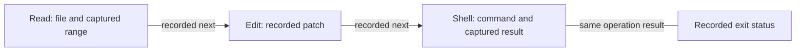

# Proposal: repository focus map and live workflow

16 October 2026 · Harsh with Codex · proposed for Yash's review

**Status: proposal only.** This PR records a direction and the decisions needed
before implementation. Merging this document does not approve React Flow adoption,
a renderer replacement, a new UI version or a default change. Yash's review and
both builders' explicit scope agreement come first.

## 1. The decision in one page

Keep the existing spatial repository overview and proven history renderer.
Prototype an optional **2D repository focus view** that groups actual files by
folder and exposes a selected file's direct static imports. Connect that view to
the existing **left-to-right action passages with history continuing downward**.

React Flow is a candidate for the bounded 2D focus view, not the owner of capture,
history, terminal execution, native continuation or the entire repository.

| Surface | Proposed behavior | Why |
| --- | --- | --- |
| Repository overview | Preserve the current 3D map, controls and user preferences | Retain orientation and the visualization the builder explicitly chose |
| Repository focus | A stable 2D view of a bounded selected neighborhood, with expandable folder groups | Make file relationships easier to trace and labels easier to read |
| Live work | Existing chronological passages, content-shaped actions, prose beneath | Explain work over time without an indefinitely widening graph |
| Full source/output | Existing bounded reader with captured/current identity | Keep long material selectable, searchable and readable |
| Connection between views | One selected evidence identity, explicit navigation and reversible highlighting | Let users move between where work happened and what was recorded |

The recommended first implementation, if approved, is **only the repository focus
experiment and selection bridge**. Improve action presentation afterward, only
where review finds a concrete gap. Do not rebuild working functionality to match
a React Flow demo.

## 2. Problem and intended value

A repository map answers "where is this file and what imports it?" A history view
answers "what did the agent read, change and run?" Putting both into one unrestricted
node graph mixes structural relationships with time and makes long output costly
to read.

We want a developer to:

1. Locate a changed file and understand its immediate repository context.
2. Jump to its recorded reads/edits without losing their place.
3. Open a terminal action, read the actual command/output and find an explicitly
   referenced file when that location resolves.
4. Read earlier work while new capture continues.
5. Distinguish recorded evidence, current repository structure and derived grouping.

These are hypotheses to validate against the current product. This document does
not claim the existing UI fails these tasks, or that React Flow will improve
performance or comprehension without a comparison.

## 3. Baseline and precedence

This proposal was prepared against main `15974a4`. The existing application has
Canvas, Legacy and Modern presentations. Saved `fresh` links migrate to Modern;
the old independent Fresh shell is retired.

[Review 76](76-modern-legacy-foundation.md) explicitly makes Modern share Legacy's
visualization, history, origin choreography and 3D map. Reviews
[78](78-recovered-modern-controls.md), [79](79-compact-modern-review.md) and
[80](80-modern-breadcrumb-header.md) define the surrounding Modern controls.
[Observation Canvas](72-observation-canvas.md) retains its separate read-only
search/navigation boundary.

This is **not a superseding design decision**. Keep those behaviors while the
proposal is reviewed. If a focus experiment is accepted, start inside the existing
Repository destination in shared Legacy/Modern, behind a development-only opt-in.
Do not introduce another Settings version. Decide Canvas applicability separately;
it must never gain a prompt or terminal execution surface through this work.

The [vision](../VISION.md), [product direction](../PRODUCT_DIRECTION.md),
[continuous canvas contract](../reference/04-continuous-canvas.md) and
[implementation roadmap](../IMPLEMENTATION_ROADMAP.md) continue to govern truth,
reading, motion, performance and release acceptance. Coordinate with the active
workspace-reliability work rather than duplicating reader-memory/recovery changes.

## 4. Repository map: an overview and a focused reading view

### Overview remains spatial

Keep the current 3D repository overview as the established spatial exploration
surface. Preserve its map-off/low-resource fallbacks, rotation preferences,
reduced-motion behavior and manual-camera hold. Opening a 2D focus view must not
reset its camera.

The focus view answers a narrower question. It does not assert that a flat layout
is an architecture diagram or that nearby files belong to a semantic community.

### Focus view structure

Use the existing selected file plus its direct imported/importing neighbors.
The initial experiment should retain the current `importConnections` default
limit of 64 neighbors and disclose omissions. This is a proposed reuse of an
existing bound, not a measured React Flow capacity claim.

- Group visible files by their actual workspace-relative directory.
- Parent folder surfaces express containment; they are derived presentation groups,
  not new captured nodes or inferred subsystems.
- Start with the selected neighborhood, not one React component for every file.
- Show actual static imports; repository cycles are valid and must remain visible.
- When folders collapse, aggregate visible cross-folder imports and disclose the
  edge count. Expanding restores the underlying file relationships.
- Keep same-path files in different worktrees distinct.
- Show unresolved imports as unresolved; do not fabricate destination nodes.
- Search and "show more" disclose what is loaded, bounded or omitted.

Proposed detail levels:

| Zoom level | Visible material | Purpose |
| --- | --- | --- |
| Overview | Directory labels, visible/total counts and small file marks | Orient without a wall of names |
| Working | Filenames, file-type icons and selected-neighborhood links | Trace actual repository relationships |
| Close | Readable path, captured activity references and reader action | Reach evidence without squeezing source into tiny nodes |

Exact thresholds are implementation tuning, not accepted design constants.
Keyboard users need an equivalent file list and expand/collapse controls.
Zoom must not be the only route to detail.

### Layout policy

Compute positions when entering focus, deliberately expanding a group or refreshing
the graph. Preserve existing positions where possible and use stable path-based
ordering/tie-breaking. Show pending layout as a derived view operation, not agent work.

Live operation results must not trigger whole-graph relayout. Keep active reading
and the selected node anchored. A deliberate expansion may move the affected
neighborhood; it must be reversible and restore the user's previous context.

React Flow provides rendering/interaction, not automatic layout by itself.
Use the simplest deterministic grouping layout first. If routing/group complexity
justifies an external engine, evaluate ELK in a bounded spike; test cyclic imports,
cross-group links, asynchronous cancellation and stale layout responses.
Do not select ELK simply because its example looks polished.

### Current structure is not historical evidence

The repository API's `RepoGraph.temporal`, generation, approval, freshness and
truncation state must remain visible. Static imports from a current scan cannot
be presented as imports at an earlier replay moment.

A recording-files-only graph has no implied static-import edges. Missing workspace
consent stays a files-only state with an explicit existing approval route. A missing
root does not become an inferred path. Graph refresh remains deliberate.

## 5. Live workflow: preserve passages, improve the relationships

### Reading order

Retain the existing `Passage.operationIds` start order: actions left to right,
captured prose below them, subsequent passages downward. On smaller screens, wrap
or stack without shrinking code below its readable size.

Start with the continuous-canvas contract's existing guidance: at most three
simultaneously readable actions on wide desktop and two on narrower desktop.
Long passages wrap or expose a counted expandable group. Do not force the whole
session onto one horizontal strip.

Illustrative sequence only; these are not claims about a real recording:

The exit status belongs to the shell operation; the diagram separates it only to
explain the composition. Production must not manufacture an extra outcome event.

Only draw next-action links where actual ordered adjacency is available. A missing
page or capture gap interrupts the chain; unloaded events are not skipped to imply
adjacency. An arrow between actions means recorded order, not reasoning or causality.

### Content shapes

| Material | What to display | Why |
| --- | --- | --- |
| Source read | Captured file/range, syntax excerpt and availability | Recognize the source being inspected |
| Edit | Actual hunk coordinates and changed lines | Read what changed rather than a generic "edited" receipt |
| Search | Captured query and actual matches with paths | Make the search result useful immediately |
| Terminal | Captured command, bounded output, recorded status and available timing | Understand the action and its actual result together |
| MCP | Observed server/tool, captured input and result | Preserve the tool's identity and evidence |
| Prose | Whole selectable text beneath the passage, outside a tool card | Preserve the agent's explanation and reading order |

Reuse existing content renderers. A terminal's late result updates its original
operation; it does not create a new card for each output fragment. Display new
output only at the granularity exposed by capture. If no incremental output is
available, say that the result is pending rather than simulate a running terminal.

Unknown status stays unknown. A successful exit is not proof that an edit is correct
or that tests cover it. Show aggregate runner facts as derived and retain raw output.

For multiple agents, begin with existing owner attribution/filtering. If evidence
supports a parent/child relation, a short branch or local lane may expose it.
Temporal proximity does not prove delegation or parallel execution. Avoid permanent
full-width lanes for every helper across an entire session.

### Live terminal means observed work

This proposal adds no PTY, arbitrary terminal attachment, shell execution button,
editable command node or workflow runner. React Flow's connection/editing controls
are inappropriate for recorded evidence and should be disabled.

Existing native continuation remains separately consented and session-scoped in
Legacy/Modern. Canvas remains observation-only. A future interactive terminal would
need its own product/security proposal; it is not hidden inside this rendering task.

## 6. One selection bridge, with reversible navigation

Use existing stable recording, operation, passage, artifact and file identities.
No copied projection or independent selection store should compete with the current
state/evidence navigation owners.

| User action | Expected result | Why |
| --- | --- | --- |
| Select a map file | Highlight matching loaded actions and expose explicit "Show recorded activity" | Establish relevance without silently hiding or scrolling history |
| Choose Show recorded activity | Navigate through existing paged history to the selected evidence | Reach older work without loading the entire recording |
| Select an action with a resolved path | Highlight its file in the map; offer explicit focus/reader action | Connect actual work to a known location |
| Select a command with no resolved path | Keep its tool origin; disclose that no file location is available | Avoid inventing a repository anchor |
| Open full source/output | Use the existing bounded reader and exact artifact/range identity | Preserve selection, copy, find and provenance |
| Close or go Back | Restore passage/offset, map camera and prior selection | Make exploration safe and repeatable |

Highlighting is not automatic filtering. Any filter must be explicit and removable.
A file's history may be paged; highlight counts must distinguish loaded from total
results. Reuse existing file-history queries rather than treating the visible
window as the complete recording.

During detached reading, capture continues and new work is indicated without
viewport jumps. Late output growth must preserve the anchor. Local scrolling inside
a result remains local. "Return to latest" is explicit.

An explicitly playing replay keeps its clock advancing during reading, per the
current independent-replay contract. Evidence rendering still obeys the chosen
as-of boundary: later results, activity markers and search snippets cannot leak
backward into recorded history. Current-map context stays explicitly current.

## 7. Relationship and visual language

| Relationship | Visual treatment | Evidence requirement |
| --- | --- | --- |
| Folder contains file | Subtle parent grouping, no causal arrow | Actual path within the resolved workspace |
| File imports file | Thin directional repository link; label on selection | Existing deterministic static-import edge |
| Recorded next action | Neutral passage connector with recorded-order legend | Available chronological adjacency |
| Agent spawned agent | Distinct labelled branch | Captured/qualified existing spawn relationship |
| Action references file | Temporary focus tether | Resolved captured reference in the correct recording/worktree |

Preserve `EvidenceLink.relation`, `basis` and explanation. A heuristic link must
remain labelled as heuristic/nearby activity; visual proximity cannot promote it
to a captured fact. Do not call this a model-thought graph.

Keep charcoal surfaces, one sans plus one mono, readable syntax, fine contours and
semantic accents. Selection, error and completion need text/icon cues in addition
to color. Avoid always-animated edges, moving particles and attention pulses.

Animate the one real DOM material only from a measured visible origin, with the
existing fallback when it is offscreen. Mount captured text whole; no typing,
copied glyph layers or animation-delayed access. Respect keyboard, reduced-motion,
map-off and low-resource paths. No capture or selection transition waits for motion.

## 8. React Flow: what to evaluate and what to retain

| Option | Benefit | Cost or limitation | Recommendation |
| --- | --- | --- | --- |
| Existing map plus existing history only | Lowest integration risk; keeps established behavior | May leave focused relationship reading harder than necessary | Baseline for comparison |
| Bounded React Flow repository focus view plus existing history | Custom DOM nodes, grouping, zoom and selection in one focused surface | New dependency, layout ownership, gesture and accessibility integration | Preferred experiment, subject to review |
| Replace all map/history with React Flow | One diagram interaction model | Risks giant DOM working sets, history anchors, reader behavior and excessive diagram editing controls | Do not pursue in this task |
| Adopt ELK immediately | Rich layout/routing options | Additional dependency and asynchronous/group-layout complexity | Only after a simpler layout demonstrates a need |
| Continuously running force layout | Can spread dense graphs | Moving targets, unstable reading positions and ongoing layout cost | Avoid for the focus view |

The library is an implementation candidate, not a design specification. Prototype
the same bounded task against the existing renderer before concluding that a
dependency is necessary. Preserve frontend/backend boundaries and the daemon's
zero-runtime-dependency property.

## 9. Proposed delivery sequence after review

| Stage | Work | Exit decision |
| --- | --- | --- |
| 0: this PR | Review the proposal, scope and questions below | Record Yash's response and both builders' agreed next task; no implementation yet |
| 1: bounded comparison | Opt-in repository focus view; selected file plus up to 64 neighbors; actual folders/imports; selection bridge; compare existing renderer with React Flow | Choose library/layout from measured usefulness, complexity and performance |
| 2: integrated navigation | Existing paged file/activity navigation, reader return, keyboard/list parity and truthful empty/error/freshness states | No lost anchors, no independent selection owner, no future evidence leakage |
| 3: targeted workflow craft | Improve only demonstrated gaps in terminal/source/diff composition, order connectors and finite arrivals | Freeze/truth/ten-minute review and local regressions pass |
| 4: promotion decision | Builder comparison on real sessions and release-relevant checks | Explicitly accept, revise or remove experiment; do not change defaults implicitly |

Keep each coherent verified increment separate. Do not bundle unrelated ongoing
reliability work. If a required relation/API is absent, stop that part and propose
a separate contract change; the event schema still needs both builders' agreement.

Likely code owners for later implementation, not files changed by this PR:

- `apps/ui/src/components/MapCanvas.tsx`, `lib/map-focus.ts` and the existing map
  geometry/detail helpers: preserve overview, derive bounded focus.
- `components/History.tsx`, `FlowConnections.tsx`, `TerminalPreview.tsx` and
  `Origins.tsx`: reuse passage, output, connections and measured origins.
- Existing state, evidence navigation and file-history owners: share identity and
  reversible navigation; coordinate with workspace-reliability changes.
- `packages/scene`: retain pure composition and golden behavior; add tests only
  if a later approved increment changes semantic presentation.
- No daemon/store/contracts changes are planned in this proposal.

## 10. Validation and stop conditions

First compare the current UI and candidate on the same redacted/synthetic workload:
a cyclic import neighborhood, many directories, a missing root, unresolved imports,
a long terminal result, a failed check, late results, a capture gap, concurrent
agents and a long paged session. Include 1440, 900 and 390 CSS-pixel widths,
keyboard-only, reduced motion, map-off and low-resource modes.

Required outcomes:

- The selected file, action, source and return position stay identifiable.
- Loading older pages and receiving at least 200 new events preserve the detached
  passage anchor; local result scroll does not unexpectedly detach follow.
- Neighbor/edge caps, omitted content and pending/unknown evidence are disclosed.
- Replay never displays later captured output or activity.
- The map never changes an observed file into a current source claim.
- Existing consent, root isolation, redaction and no-telemetry boundaries hold.
- No full-history/full-repository fetch is introduced to populate diagram nodes.

Measure interaction latency, source-record-to-settled-view latency, browser heap,
daemon RSS, long tasks/dropped frames and passive capture overhead independently.
Use the named reference machine, cold/warm runs and at least five repetitions from
the [B4 methodology](../IMPLEMENTATION_ROADMAP.md#7-b4--provisional-numeric-gates).
Retain its existing gates rather than claiming new thresholds are already met.
A node cap is a bound, not a performance result. Physical/platform acceptance
remains separate.

Ask both builders to perform the same tasks: find a changed file, trace a direct
import, locate its edit, inspect a failed command and return to their previous
reading place. Record completion, wrong turns and qualitative preference locally;
no telemetry. Follow with the freeze, truth and ten-minute checks.

Stop or simplify if the experiment adds pointer/scroll conflicts, loses reading
anchors, confuses current/historical evidence, regresses the existing performance
gates or does not make the tasks clearer. Keeping the baseline is a valid outcome.

## 11. Questions for Yash's review

Please answer **accept / revise / reject**, with a reason, for these decisions:

1. Keep the current 3D overview and test an optional bounded 2D focus view rather
   than replace the established visualization?
2. Put the first experiment in shared Legacy/Modern's Repository destination,
   leaving Canvas's read-only composition unchanged?
3. Compare React Flow with the existing renderer before committing to a dependency;
   defer ELK until layout complexity requires it?
4. Reuse the existing history renderer, horizontal passages and paged evidence
   navigation rather than turn the complete session into a node editor?
5. Keep terminal work observational, with no new command execution/PTY capability?
6. Are the validation tasks and stop conditions sufficient, and what must change
   before agreeing to the first implementation PR?

Review of the document is not a substitute for human visual evaluation of the
later prototype. Record feedback here or in PR review comments, revise the proposal,
then agree on a bounded implementation PR. Do not merge or implement on the
assumption that silence or a document merge means design approval.

## 12. Primary references and what they support

Reviewed 16 October 2026. These support library capabilities, not a claim that the
proposed Drishya experience is validated.

- [React Flow](https://reactflow.dev/): customizable node-based React diagrams.
- [Sub Flows](https://reactflow.dev/learn/layouting/sub-flows): relative child
  placement and grouping. Grouping is not automatic semantic clustering.
- [Contextual Zoom](https://reactflow.dev/examples/interaction/contextual-zoom):
  changing node detail with zoom level.
- [Horizontal Flow](https://reactflow.dev/examples/layout/horizontal): left/right
  handle placement and mixed diagram directions.
- [Custom Nodes](https://reactflow.dev/examples/nodes/custom-node): regular React
  components can render custom node content.
- [Layout overview](https://reactflow.dev/learn/layouting/layouting): layout engines
  are separate; Dagre/ELK differ in complexity and grouping/routing support.
- [ELK example](https://reactflow.dev/examples/layout/elkjs): integration pattern,
  not an automatically selected dependency.
- [Performance guidance](https://reactflow.dev/learn/advanced-use/performance):
  avoid unnecessary rerenders, collapse large trees and simplify styles.

## 13. This PR's validation boundary

Documentation only: proposal, documentation index and session handoff. No UI,
dependency, schema, capture or native-controller behavior changes. Check relative
links, Markdown fences, whitespace and exact PR file scope. Runtime tests, browser
benchmarks and human design acceptance are deliberately not claimed by this PR.
