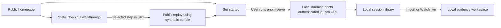

# Drishya landing page design and implementation plan

**Task:** LAND-1 · **Status:** design proposal for builder review · **Date:** 7 November 2026

**Goal:** A developer can see what Drishya does on the first screen, inspect one example without setup, and understand how to open their own local session.

**Architecture:** A static marketing site and a static build of the existing synthetic replay sit on a public origin. The local daemon continues to serve the authenticated workspace on loopback. The public site hands off through ordinary links and setup instructions.

**Proposed stack:** Separate Vite site in the existing workspace, semantic HTML, TypeScript, CSS and the current React replay app for the full demo. CSS transitions and Web Animations API cover the public site's motion. The local app keeps its existing rendering and motion owners.

**Decision inputs:** [Drishya Vision](../../VISION.md), [Product Direction](../../PRODUCT_DIRECTION.md), [Implementation Roadmap §8](../../IMPLEMENTATION_ROADMAP.md#8-installation-and-user-side-operation), [Sui](https://www.sui.io/) and [Linear](https://linear.app/). LAND-1 delivers this plan. Build and release decisions belong to REL-4. Review this design before implementation, then use the repo's executing-plans workflow under the applicable task claim.

## 1. Direction and audience

The visitor is a developer using Claude Code or Codex who has come back to an agent run and needs to understand what happened. In their first minute they should be able to identify a file read, see a recorded failure, inspect an edit, and distinguish a subsequent test result from a claim that the edit caused it.

| Direction considered | Consequence |
| --- | --- |
| Sui-led launch film | Strong opening silhouette and visual rhythm. The product appears late if the film occupies the first screen. |
| Linear-led app showcase | Clear product proof early. A full workspace at hero size makes the individual evidence hard to read. |
| **Chosen proposal: the session is the page's visual spine** | Sui supplies the large type, squared controls, full-width tonal changes and vertical sequence. Linear supplies a credible product view with real material and clear actions. Drishya supplies the file map, timeline and evidence itself. |

**Design principle:** An active file in the repository map connects to a visible piece of evidence. As the visitor changes the moment, the highlighted origin and evidence change together. This relationship is the signature visual. Use the spatial map as a quiet supporting layer and keep the text in the DOM.

The launch story is **Free orders reach checkout**, the existing synthetic example. The first screen should make sense in a still frame. A visitor can explore the example at their own pace, open the full replay at the same point, or go to setup.

## 2. Page map and destinations

These paths are proposed. Host and release destinations come from one validated release manifest. Site and app content use the same Drishya mark, type families and role colors. Page navigation uses normal links so browser Back, Forward, new tabs and keyboard activation work naturally.

| Public path | Visitor goal | Primary action | Other destinations and states |
| --- | --- | --- | --- |
| `/` | Understand the product and see evidence | **Try the demo** → `/#session` | **Get Drishya** → `/get-started/`. **Open full replay** → `/demo/?demo&at=<step>` from the selected example. Sections `#session`, `#workspace`, `#local`. |
| `/demo/?demo` | Inspect a complete sample in the actual replay app | Use existing history and replay controls | Links open at verified `at` positions. Explicit **Back to overview** → `/#session` and **Get Drishya** → `/get-started/`. Invalid bookmark → canonical sample at its default view. Bundle failure → **Retry sample** and **Read the walkthrough**. |
| `/get-started/` | Find an available way to run Drishya and open a first local session | Contextual action based on verified availability | Requirements, steps, copy controls, supported harnesses, troubleshooting and sample fallback. `#requirements`, `#first-session`, `#troubleshooting`. |
| `/privacy/` | Understand what stays local and what sharing or native control does | **Get Drishya** → `/get-started/` | Link to deeper engineering and security documentation when public. |
| `/releases/` | Find a release, supported platforms and checksums | **View release** on each published record | Before release, one plain preview notice and links to setup and demo. No invented version, date or downloads. |
| `/404.html` | Recover from a missing URL | **Back to Drishya** → `/` | **Try the demo** → `/#session`. Keep the requested path out of reflected page copy. Return actual HTTP 404 on static hosting. |

For launch, product, FAQ and integration descriptions live on the pages above. The site exposes one demo and one setup path. Additional marketing routes require their own content and owner. The public demo uses the app's current supported desktop minimum of 600 px. At narrower viewports, visitors can read the marketing walkthrough and see a labelled desktop requirement before opening the full workspace.

## 3. Home, from top to bottom

| Section | Composition and exact content direction | Controls, connection and fallback |
| --- | --- | --- |
| Global header | Dark 64 px bar, wordmark left, **Product**, **Demo**, **Privacy** links, **Get Drishya** at right. Product jumps to `/#workspace`. Header stays in normal reading order and sticky at the top. | Home logo → `/`. Demo in the header → `/#session`. At 600–767 px use the wordmark, primary action and a **Menu** disclosure for the links. Close on outside click, Escape, selection and navigation. Footer repeats core routes. |
| Hero | On graphite, **See what your agent did.** Supporting line: **Follow Codex and Claude Code through the files they read, the commands they ran, and the changes they made.** Left-aligned copy, real evidence on the right, quiet sample repo map behind the evidence. The demo visual has a visible **Synthetic sample** label and the initial **Checkout guard edited** moment. | **Try the demo**, **Get Drishya**. First paint contains the entire claim, action and a still of the workspace. Use the existing synthetic screenshot as a provisional fallback during implementation and create a crop or HTML evidence frame for final artwork. |
| Statement | A light paper section with one large sentence: **When an agent changes your code, follow the work that led there.** A short paragraph describes captured evidence and what can be revisited. Left alignment, broad margins, no additional action. | Entire text is selectable from first paint. Followed by the start of the chronological sequence. |
| `#session` | Dark replay section. Section title **Follow one checkout fix**. On a wide screen, the left rail holds the four moments and the right side shows the current material. Use a single vertical guide and one active marker. Small evidence window shows harness, repository-relative path or command, and captured status. | Four step buttons, labelled step slider, **Play sample** or **Pause**, and **Open full replay**. Initial chapter is the source read on a fresh visit. Complete static walkthrough appears below the stage in source order. If the enhanced viewer fails, retain the four direct moment links and walkthrough. |
| `#workspace` | **Read the work where it happened.** Three sections laid out as editorial rows: **Watch live** with map and active history, **Inspect a file** with captured source and history, **Review changes** with the recorded edit and a clear distinction from separately authorized current Git. Each uses one cropped real product frame from a shareable fixture. Alternate media placement at wide sizes. | A supporting link after each row goes to the verified replay point or the corresponding setup subsection. On the stills, captions identify synthetic material and what it demonstrates. |
| `#local` | Paper background. **Your sessions stay on your machine.** Three hairline-separated rows: local capture and storage, redaction before persistence, opt-in controls and exports. Use a simple public-sample versus local-session diagram with persistent labels. | **Read about privacy** → `/privacy/`. **See supported harnesses** → `/get-started/#requirements`. No upload control. |
| Closing action and footer | Graphite. **Try it with your own sessions.** State verified distribution status in one line. Footer shows Product, Demo, Setup, Privacy, Releases and Source when public. Use the current mark and license information. | **Get Drishya** → `/get-started/`. Secondary **Try the demo** → `/#session`. Hide public Source link until its URL is accessible to a signed-out visitor. |

At 1440 px the hero should reveal some readable product material before the first scroll. Use 55–60% of the hero grid for the sample scene and keep text contrast constant against a quiet ground. At 600 px put the complete headline and actions above a 16:10 still with a readable title and one code excerpt. At intermediate widths let the grid stack at 960 px. A compact live preview and a full walkthrough serve different tasks. The preview is a single frozen frame and the walkthrough owns playback.

```text
Drishya                   Product    Demo    Privacy           Get Drishya
──────────────────────────────────────────────────────────────────────────

See what your                       Synthetic sample   Checkout guard edited
agent did.                          ┌─────────────────────────────────────┐
                                    │ checkout/guard.ts  ● ──  Edit      │
Follow Codex and Claude Code         │                                    │
through the work they recorded.     │        Readable captured material   │
                                    │                                    │
[ Try the demo ]  Get Drishya ↗      └─────────────────────────────────────┘

──────────────────────────────────────────────────────────────────────────
Paper section                         Follow the work that led to the edit
```

## 4. Sample sequence and evidence contract

The current `apps/ui/public/demo/bundle.json` contains a 45-item projected timeline. `apps/ui/src/App.tsx` accepts `?demo` and `at`. `apps/ui/src/state.ts` enters paused replay for numeric `at` and uses a prefix of that length. The following marks were checked against the current synthetic bundle. Generate them from the resolved `op-end` items at build time so fixture changes cannot silently send a visitor to the wrong point.

| Chapter | Evidence shown | Current event and replay link |
| --- | --- | --- |
| **Read the checkout guard** | Captured excerpt of `src/checkout/guard.ts`, lines 1–14. Highlight the file node only when the verified sample map contains that path. | `rec_x0001.toolu_synthetic0001`, `op-end` at step 4 → `/demo/?demo&at=4` |
| **Inspect the failing test** | Captured command/result and failure indicator. If a file is mentioned by parser-derived test output, label it as a reported location. The test result originates at the shell tool, even when an output line points to a file. | `rec_x0001.toolu_synthetic0009`, step 24 → `/demo/?demo&at=24` |
| **Review the guard edit** | Actual edit payload or the existing renderer's derived diff, with its provenance. The sample's immediate before snapshot has no material bytes. Use the recorded replacement and available after source where the renderer supports them. Keep the earlier read clearly identified as an earlier read. | `rec_x0001.toolu_synthetic0010`, step 26 → `/demo/?demo&at=26` |
| **Check the next test run** | The later captured test result, labelled by harness and sequence. Show the reported result and its observed scope. | `rec_x0001.toolu_synthetic0011`, step 28 → `/demo/?demo&at=28` |

The build exporter resolves each operation ID to its timeline position, maps its verified display paths, and emits only the bounded excerpt, command or result needed by marketing. The full demo consumes the original synthetic bundle. An optional Codex example can use `rec_x0002.call_synthetic_patch` at step 42, a separate patch to `test/checkout.test.ts`, with its own identity. The main sequence stays on a single Claude Code investigation while the full replay can demonstrate both harnesses.

**Walkthrough behavior.** Four ordered points, 1–4 on the range input. The visible counter reads `2 of 4` and the accessible value reads the chapter name. The active mark on the rail and the thumb always reflect the same state. Pointer dragging previews points without animating the intermediate selections. Arrow keys and Home/End update immediately. A click on a step selects it and leaves focus on that button. Playback is an explicit, finite pass with example dwell times of 1.6, 2.2, 2.6 and 1.8 seconds. A manual step, drag, Escape, leaving the section, hidden tab or preference change pauses the marketing player. The fourth step settles and offers **Replay sample**. The full app retains its independent playback and Follow rules.

**Navigation state.** On `/`, `?moment=read|failure|edit|retest#session` can open a specific marketing chapter. Use `replaceState` for interaction within an already-open walkthrough and keep ordinary document navigation as history entries. A new visit without a moment starts at read. Unknown moment defaults to read. A same-tab handoff uses a normal link with its matching `at` and optional `motion=0`. Back restores the walkthrough scroll and selection using browser history state. Play is always idle on restore. If launch `at` lands on an appropriate time prefix without auto-expanding the desired action, keep that existing app behavior and put the action name in the link caption. A separate enhancement can focus by observation ID after existing support is verified.

## 5. Secondary pages and the local path

### Full replay

Use the normal public bundle renderer, with a compact external banner identifying the **Synthetic sample**. Keep the workspace's existing header, map, tools, history, timeline, material readers, keyboard controls, settings and responsive rules. Provide two explicit links back to marketing and setup. When an existing tool requires local data, use the app's bundle-mode availability state or omit the entry where existing bundle capabilities already do so. Verify local-only entries such as agent continuation, project edits, disk files and live capture have no callable public path. Existing replay controls remain owned by the app. Use a static labelled sample frame while the route initializes and expose a readable retry or walkthrough link if loading fails.

### Get started

1. **Get Drishya.** Show current availability in one sentence. For a private, prerelease source tree, the public path is **Try the demo** plus a plain preview notice. Authorized builders can use their checkout. Once the source is public, **Build from source** opens the exact guide. Once a package is verified and published, show verified platform actions and keep source setup secondary. A missing platform entry yields requirements and demo links with an availability message.
2. **Requirements.** Node 24.x and pnpm 10.34.5 for the current checkout workflow. Desktop browser at 600 px or wider. Claude Code or Codex local journals for personal sessions. Use explicit support entries and verification date once release acceptance exists. Show no inferred platform certification.
3. **Run locally.** Display the verified checkout commands `pnpm install --frozen-lockfile`, `pnpm ui:build`, `pnpm serve` in order. Show checkout cloning only when its destination is accessible. A **Copy commands** button copies exact visible commands with newlines and reports success or a selectable fallback. Maintain the same block size on feedback.
4. **Open a first session.** Open the `Open:` link printed by the daemon, then choose **Import** or **Watch live** in the local library. Point out the current default port `127.0.0.1:7878` as an explanatory value. Show the steps in plain language and illustrate with a shareable synthetic app frame. The visitor opens their own launch URL from their terminal.
5. **Troubleshooting.** Four disclosure rows: no journals found, build missing, port in use, expired authentication. Use the existing documented CLI and launch flow. Offer the sample while resolving setup issues. Error states stay in the affected section and keep the rest of the guide readable.

### Privacy

Opening statement and diagram distinguish the hosted sample from the visitor's local data. Detail sections cover read-only journal capture, local storage, best-effort redaction before persistence, user-reviewed export, and separately authorized native control. Explain that missing journal material stays missing. Include a compact compatibility distinction between a static bundle and the local workspace. Use links to verified public documentation and setup. Keep body text static and document sections directly linkable.

### Releases and missing pages

Release entries use a list with one heading and version/date per entry. Show checksum links, release notes and platform files only for declared published entries. The empty state is a concise notice and two ordinary links. A broken release URL returns the recovery page with the global header and footer, a clear **Page not found** heading and routes to Home and Demo. All states stay usable with scripts disabled.

## 6. Visual system and components

| Element | Proposed value and rule |
| --- | --- |
| Color | Dark ground `#101214`, inset material `#191C20`, main text `#F4F6F8`, supporting text `#ADB5BF`, paper `#F4F5F3`, paper ink `#151719`. Neutral hairlines. Primary fill `#92D6C3` with `#101214` text. Paper link/focus color `#116855`. Keep outcome and agent colors from VISION and use text/icon labels alongside them. |
| Type | Inter for display and prose, system sans fallback until licensed local asset is present. JetBrains Mono for paths, commands and step count. Hero 80/0.98 at 1440, 60/1.02 at 1024, 44/1.04 at 600. H2 48/1.04 wide and 32/1.12 compact. Body 17/1.55, supporting 14/1.5, code at least 13/1.55. Section paragraphs 65ch max. |
| Grid | 1200 px max content, 48 px desktop outer inset and 24 px compact. 12 columns above 960, 6 below. Use a 4 px spacing scale, section padding 104/72/56 px by layout. Standard section adjacency on the same grid. |
| Controls | 44 px action height and minimum target area, 2–4 px radius, 1 px border where it aids recognition, 16 px icons with consistent stroke. One primary action per group. Links use visible underline or equivalent contrast; focus outline 2 px plus 3 px offset. |
| Stage | Reserve a stable evidence area. Use one low-contrast map plane, a single selected node and one visible connector. Make the path/command header and provenance label legible without the map. Overflow belongs to the source pane. It can be scrolled or copied with a keyboard without moving the marketing page. |
| Imagery | Use the existing crystal mark and shareable synthetic app shots. Build vector map geometry from the synthetic fixture or capture the real map. Use the map node layout and real code as recognizable visual material. Brand artwork can carry an abstract motif outside evidence views, with no relationship meaning. |

| Component | Required states and behavior |
| --- | --- |
| Primary/secondary button | Rest, hover, pressed, focus-visible, loading, disabled when a temporary operation has a real prerequisite, success/error where actionable. Link actions use anchors, with visible availability guidance rather than dead disabled links. |
| Navigation/header/footer | Current page (`aria-current`), hover, focus, visited where helpful. Menu closed, opening, open, closing, Escape/outside-dismiss and restored trigger focus. Skip link visible on focus. Anchor offsets account for sticky header. |
| Stage and evidence | Idle, loading, ready, selected, expanded if required, error, missing source, motion off, and static without JS. Keep selectable text mounted during passive highlighting. Expanded material uses the existing reader in full replay. The home walkthrough has one detail pane with no nested dialogs. |
| Map/legend | Active, related, quiet, unavailable, static. Chapters are the keyboard targets. The map is decorative unless a verified file action and corresponding keyboard control are provided. Edge style reflects evidence type. No edge when a relation is unresolved or its endpoints are unavailable. |
| Playback and range | Play, paused, completed, dragging, keyboard focus and recovery on bundle error. Use native range semantics and a visible caption. Position and selected state stay in sync. Announce deliberate chapter selection and play/pause once via a polite status region. No per-frame announcements. |
| Copy and code | Copy, copied, failed with selection fallback, focus, code overflow, wrap setting if shown. Copy the visible material exactly and preserve selection on feedback. Reserve space for the status. |
| Disclosure | Closed, open, keyboard focus, Escape on nested overlays only. Prefer native `details` for FAQs. Open text and focus targets are immediately available. |
| Platform/release row | Available, unreleased, unsupported, source available, checksum unavailable. Show the reason and next accessible action. Avoid bogus download controls. |
| Banners and recovery | Stable default, information, warning, recoverable error. Include a clear next action and legible status without relying on hue. Bundle errors retain static walkthrough and setup links. |

## 7. Motion registry

Use `out = cubic-bezier(0.22, 1, 0.36, 1)` and `standard = cubic-bezier(0.2, 0, 0.2, 1)`. Start a replacement animation from its current computed presentation. Update state, labels and accessibility immediately. One large visual transition at a time. For touch and keyboard, use the same committed state with immediate focus and no hover-only affordances. Under `prefers-reduced-motion`, disable scroll choreography, directional movement and scale. Change color, text and selected outlines immediately. `motion=0` maps into the existing replay option on handoff.

| ID and surface | Trigger and exact animation | Timing, interruption and fallback |
| --- | --- | --- |
| M01 Hero scene | First visit with the visible scene ready: strengthen the selected node and connector once, while the headline, buttons and evidence remain readable. | Connector `opacity` 0.25 → 1 over 360 ms `out`. No geometry changes. Skip on history restore, low resource or reduced motion. |
| M02 Section headings | Scroll into view. Typography and body render at final size and position. | 0 ms. Tonal change comes from entering the next section's background in ordinary scroll. |
| M03 Header | Sentinel leaves viewport: add bottom hairline and solid graphite backing. | Border/background 140 ms `standard`. Position and height fixed. Back to initial reverses. |
| M04 Links and buttons | Pointer enters/exits: tint foreground, border and background. Pointer press: deepen fill, keep text stable. | Hover 120 ms, press 70 ms, release 110 ms. Focus ring and keyboard activation immediate. |
| M05 Compact menu | Click trigger: reveal below it with 4 px vertical translation and opacity. Close from current state. | Open 170 ms `out`, close 120 ms. Focus changes immediately. Reduced motion toggles instantly. |
| M06 Anchor and route navigation | Link activation and browser Back/Forward. | Native jump or normal navigation, 0 ms. Focus destination heading on deliberate in-page activation and preserve normal browser history. |
| M07 Chapter rail | Step changes: indicator moves between measured row centers. | 180 ms `out` for pointer click or explicit Play. Snap while dragging, on keyboard, after restore or in reduced motion. Active label updates synchronously. |
| M08 Evidence selection | Render destination content immediately. Optional arrival of the material pane 6 px from the direction of the chapter rail. | Pane transform 190 ms `out` for click/Play, with text already at full opacity. Start from current position when interrupted. Snap on drag and keyboard. |
| M09 Lift | When a captured source read or edit has a confirmed file on screen, highlight the node then show a tether to the evidence pane. | Node emphasis 110 ms, connector opacity 220 ms in the same commit. Disable tether for missing map or anchor. The material remains a single DOM surface. |
| M10 Emit | When a sample command is selected, light the shell tool origin and its verified connection. | 180 ms opacity/outline once. If the tool origin is outside the crop, show the tool name in the evidence header. |
| M11 Settle | Old chapter leaves the active state. Dim its marker and restore neutral outline. | 140 ms `standard`. Prior steps remain selectable. No moving stack or shrinking source. |
| M12 Surface | The chapter caption changes with the evidence. | 0 ms for copy. Captions retain a stable baseline and show the whole sentence. |
| M13 Resolve | Recorded test result arrives during Play or is selected directly. | Status label and icon appear immediately. Optional 200 ms outline emphasis once, no pulse. On manual drag, render final status immediately. |
| M14 Scrub | Drag thumb or keyboard step through chapters. | 0 ms for thumb, evidence and status. Cancel pending animations. At most one render per frame during pointer drag. Snap to the exact selected chapter on release. |
| M15 Playback control | Play, pause, manual interruption or completion. | Icon and label switch at 0 ms. Advance only from the play clock. A small finite progress fill may reflect that clock while playing, with an immediate static chapter indicator under reduced motion. |
| M16 Map relationship hover | Pointer passes over a visible file association. | Node and tether tint 120 ms. The selected chapter does not change. Keyboard focus uses an immediate outline. |
| M17 Code copy feedback | Successful or failed copy. | Label changes immediately in a fixed-width slot. Show **Copied** for 1.2 s, then restore. Failure offers selectable commands or text. No toast needed. |
| M18 Walkthrough load | Enhance static poster when preview data is ready. | 140 ms opacity change on decorative poster only. Keep captions and controls stable. A failure swaps only the local status and shows usable links. |
| M19 Full demo load | Open static app route and resolve the sample. | Existing app loading behavior with readable public fallback. No promotional splash. All existing app motion is governed by its own settings and current implementation. |
| M20 FAQ disclosures | Expand and collapse a question. | Native show/hide at 0 ms, chevron rotation 140 ms. Content can be read immediately. |
| M21 Release, privacy and error pages | Page loads or its status changes. | 0 ms for navigation, notices and recovery. Link/control treatment only. |
| M22 Resize and visibility | Crossing a layout breakpoint, tab hidden, or motion preference changed. | Cancel active transitions, pause sample and resolve to the selected state. Use CSS reflow. Update from the new geometry on the next interaction. |

Stop the sample clock offscreen. Use an `IntersectionObserver` for visibility and a reduced-motion media query. Animate `transform`, `opacity` and short control color transitions. Geometry should come from the rendered DOM and sample graph, with no persistent frame loop at rest. Sui's large transitions inform the composition. Drishya spends movement on evidence arriving from a known origin and on outcome changes.

## 8. System connection and implementation boundaries



| Proposed owner | Interface and responsibility |
| --- | --- |
| `apps/site/` | Static multipage build for Home, Setup, Privacy, Releases and 404. `src/site.css` owns typography, tokens and layout. `src/preview.ts` owns walkthrough controls and rendering. `src/release.ts` chooses public copy and links from the release manifest. Native links and the static walkthrough work without JavaScript. |
| `scripts/build-landing-demo.ts` | Derive typed chapter data from the committed fixture and allowlisted operation IDs. Produce `{ chapters: { key, step, operationId, label, path, provenance, text }[], totalSteps }`, omitting absent values and recording the source bundle revision for review. Use existing evidence projection fields and text renderers where applicable. Fail if IDs, status, kind, safe paths or source bytes required by the selected material drift. |
| `apps/ui/src/App.tsx` and Vite config | At implementation, add an explicit public-demo build profile that enters the fixed synthetic bundle before daemon sign-in, validates `at`, accepts `motion=0`, and selects only the fixed public fixture. Verify asset base `/demo/` including root-relative brand/font references. Use separate output from the local `apps/ui/dist` package. The local build follows its existing boot path. |
| Static release artifact | Publish the marketing output and `/demo/` output together, with only approved assets. Serve `.json` with the correct content type, immutable hashed assets, and short caching for HTML and unversioned demo metadata. Verify the published artifact includes correct base paths and 404 handling. Enforce self-only network resources on public pages, with the replay worker requirements verified in the browser. |
| Local `apps/daemon` and UI | Loopback startup, token exchange and native consent remain in the existing owners. The public site holds neither launch credentials nor journal paths. The user's local browser reaches their own app via the printed launch link. The product library owns discovery, import/watch, git inspection and opt-in continuation. |

**Data flow:** Public assets are sourced from committed synthetic material. No requests from the public site or demo to `/v1`, localhost, a user's filesystem or an external analytics service. The public build has no private input or upload entry point. Validate the built payload and runtime requests. Copy text and disclosure state can stay local to the page. Store only the visitor's public chapter key in URL state. Continue to use the app's privacy and consent rules for anything the user opens locally.

**Release readiness:** Setup copy comes from one verified public manifest with `state: 'preview' | 'source' | 'release'`, optional public source URL and optional verified release/platform entries. During private development, the manifest renders public demo paths and plain preview status. Source publication, hosting and installer publication are distinct release decisions under REL-4. Check destinations signed out before changing the manifest.

## 9. Build and verification sequence for REL-4

The plan fixes the design and the boundaries. Implementation should turn the phases below into bounded repo tasks when scheduled.

| Order | Build step | Proof before moving on |
| --- | --- | --- |
| 1 | Confirm the hero composition and sample narrative. Prepare one approved still per intended product frame, confirm typography assets and transcribe final copy for the routes. | At 1440 and 600, the hero reads in a still frame. Each visual points to a named source fixture. A reviewer can locate the two actions and identify what the app does. |
| 2 | Build the static routes, navigation, release states and 404. Add baseline accessibility and layout before motion. | Link crawl from every route. Back/Forward and deep anchors work, no JS still allows navigation and reading, typography and actionable roles are correct at both supported widths and 200% zoom. |
| 3 | Generate sample chapters and add the public replay profile. Build preview and replay artifacts together. | Compare generated operation IDs and positions to the fixture, open all four deep links, verify held state and requested evidence, test missing bundle and invalid position, verify `/demo/` resolves fonts and images. |
| 4 | Wire the chapter controls and apply the motion registry. | Exercise keyboard, drag, repeated reversal, rapid switching, Play/Pause, tab hiding, leaving the section, reduced motion and browser Back. Confirm the correct state on every interrupted frame. |
| 5 | Validate setup handoff and public isolation. Inspect current app at both desktop widths with synthetic data, plus a clean local run from the actual supported install path. | Browser request trace has no public-to-daemon or analytics requests. CLI prints a usable local launch link and import/watch remains in the local app. Negative-test public URL query variants and error recovery. Acceptance for any changed product reader or projection follows AGENTS.md on genuine sessions of both harnesses. |
| 6 | Review launch artifact, accessibility and performance. Record actual versions, proof and open platform gates. | Freeze/truth/ten-minute checks pass. Text remains legible under every animation. Signed-out links and release metadata match public reality. Builder review decides when to publish. |

**Proposed performance budgets, to measure before release:** Home critical JS ≤60 KiB gzip, first screen image/geometry ≤350 KiB transferred, no replay runtime loaded before navigating to the full demo, LCP ≤2.5 s and CLS ≤0.05 on a named test profile. Capture actual device/browser and throttling assumptions. Reserve dimensions for the hero and evidence, lazy-load lower sections, and verify idle CPU on the reference desktop. Browser performance checks are distinct from product release acceptance.

**Review focus.** A missing or reordered fixture event should fail the build rather than change a link's meaning. A visitor pasting a public demo URL must stay in the fixed sample build. A test marker must show a recorded outcome without implying coverage or causality. A back-navigation or reduced-motion change must preserve the selected evidence and stop the marketing sample clock. A public setup page with no available release must still offer the demo and honest requirements. Check all five with browser tests or the build validation owned by the corresponding phase.

**Decisions for builder review:** the launch hero headline, the proposed public route set, the chosen appearance of the hero screenshot or equivalent HTML evidence view, and the release manifest state at publication. The plan assumes one walkthrough and a static marketing site. Use the checked-in fixture for the first public demo and review the final captures before release.
