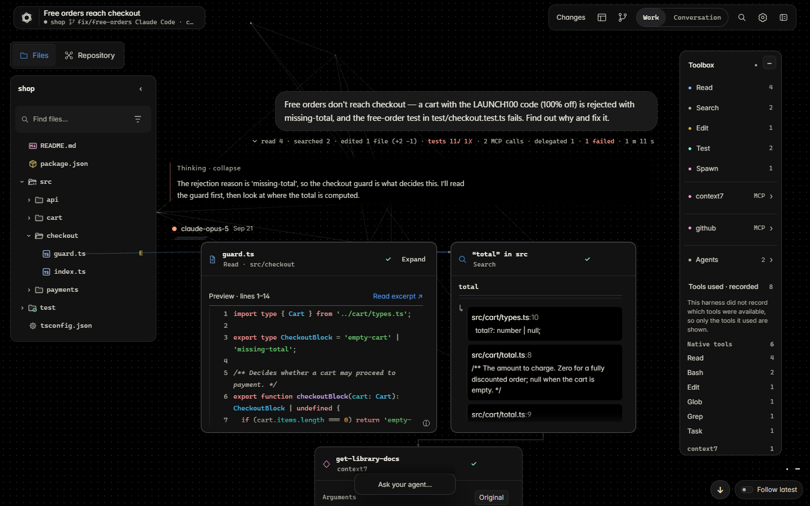

<!-- The README shown on npmjs.com. scripts/build-package.ts copies it into the package as README.md.
     npm does not resolve relative links, so every link and image here is absolute. -->

# Drishya

**See what your coding agent is doing, and review it like an engineer.**
<sub>दृश्य · *that which is seen*</sub>



Your agent reads thirty files, runs ten commands, watches a test fail, edits two lines and says **"Done."**
Drishya shows you all of it, as it happens: the real files, output and diffs, next to your repository, with the tools to review the change. It runs on your machine and sends nothing anywhere.

## Quick start

Requires **Node.js 24**.

```bash
npx drishya serve
```

Or install it:

```bash
npm install -g drishya
drishya serve
```

`serve` opens Drishya in your browser. **Home** lists the sessions it finds on this machine; open one to follow it live or replay it. No sessions yet? Open `http://127.0.0.1:7878/?demo` for a sample.

## What you get

- **Watch live:** every read, search, command, test and edit, as the agent takes it, shown as the real content.
- **Read along:** the file the agent is working on, beside its work, with every earlier action and diff on it.
- **Steer:** answer approvals and send the next prompt to a Claude Code or Codex session.
- **Review:** Workspace, Changes for branches and pull requests, and the Git graph, each showing which agent touched what.
- **Replay and search:** every session from every agent on one Home.

| Agent | Live view | Replay | Send prompts |
|---|:-:|:-:|:-:|
| Claude Code | ✓ | ✓ | ✓ |
| Codex | ✓ | ✓ | ✓ |
| Antigravity | – | ✓ | – |

## Commands

| Command | What it does |
|---|---|
| `drishya serve [--port 7878] [--no-open]` | Start the app |
| `drishya sources [--json]` | List the sessions found on this machine |
| `drishya import <path>` | Import one session journal |
| `drishya import --latest [claude-code\|codex]` | Import the most recent session |
| `drishya list` | List imported recordings |
| `drishya export <recording> --out <file>` | Write a sanitized replay bundle |
| `drishya forget <recording>` | Remove a recording from the store |
| `drishya storage` | Show disk use |

## Privacy

- **Reads** your agents' journals, read-only, and a repository's files only after you allow it.
- **Stores** redacted copies in `~/.drishya`. Keys, tokens and `.env` contents are redacted before anything is stored, indexed, exported or shown. Redaction is best effort, so review an export before you share it.
- **Sends** nothing: no telemetry, analytics, crash reports or update checks.
- **Listens** on `127.0.0.1` only, and every request for your data needs the launch token. Keep the port on your own machine; don't tunnel or forward it.

Every claim above is a test you can run: see [Security, tested](https://github.com/drishya-dev/drishya#security-tested).

## Uninstall

Stop Drishya (Ctrl+C), delete `~/.drishya` (`%USERPROFILE%\.drishya` on Windows), and run `npm uninstall -g drishya` if you installed it.

## Links

[GitHub](https://github.com/drishya-dev/drishya) · [Website](https://drishya-dev.github.io/drishya/) · [Report a bug or request a feature](https://github.com/drishya-dev/drishya/issues/new/choose) · [Report a vulnerability](https://github.com/drishya-dev/drishya/blob/main/SECURITY.md)

Apache-2.0. The Drishya name and logo are not licensed for other products ([TRADEMARKS.md](https://github.com/drishya-dev/drishya/blob/main/TRADEMARKS.md)).
